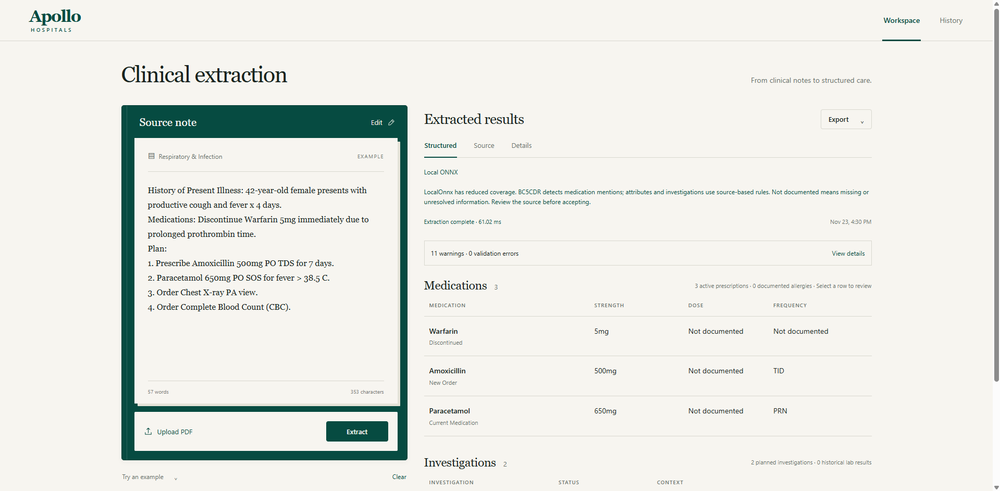
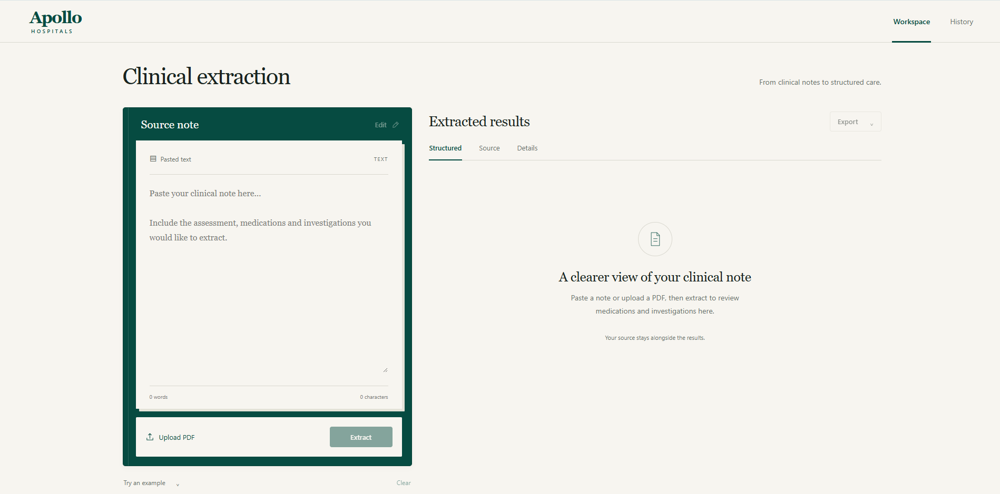
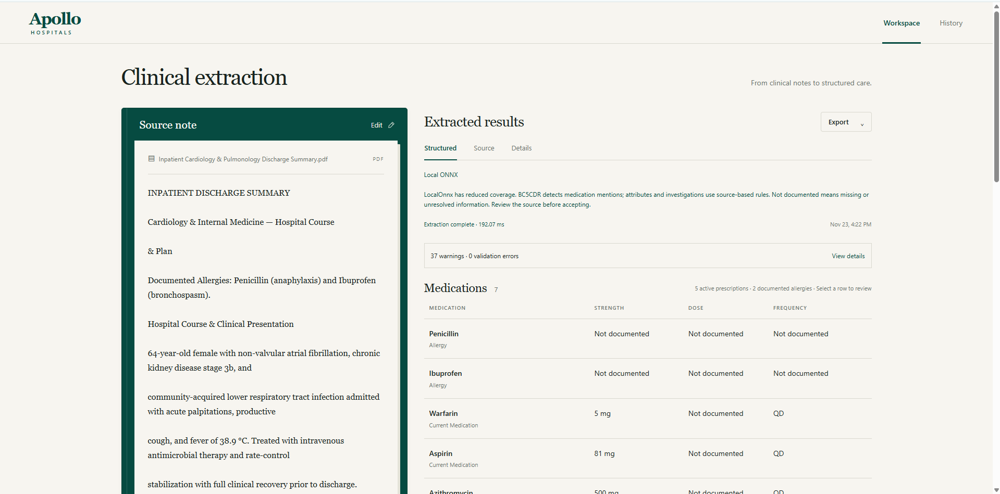
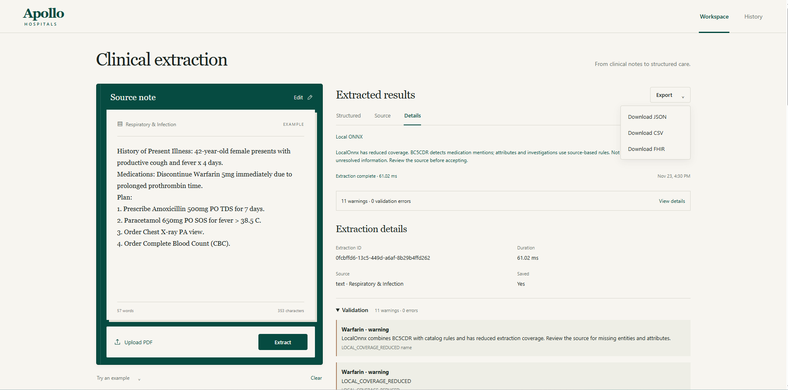
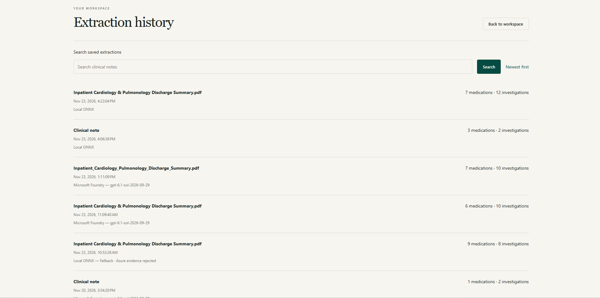

## Frontend screenshots

Actual screenshots from the Apollo Angular development interface, captured with **synthetic demonstration notes**. Select any image to open it at full resolution. The screenshots show functionality and layout from a development build; they do not represent hospital production approval.

### Clinical extraction in action

*Source text remains visible beside the structured results. This example displays the Local ONNX fallback with explicit reduced-coverage disclosure, medication status and investigation summaries.*

### Explore the interface

<table>
  <tr>
    <td width="50%" valign="top">
      
       <strong>01 · Clinical input workspace</strong> 
      Enter a note, select an example, or upload a text-based PDF.
    </td>
    <td width="50%" valign="top">
      
       <strong>02 · PDF extraction</strong> 
      Inspect a synthetic discharge summary side by side with extracted data.
    </td>
  </tr>
  <tr>
    <td width="50%" valign="top">
      
       <strong>03 · Validation and export</strong> 
      Examine warnings, extraction metadata and JSON / CSV / FHIR export options.
    </td>
    <td width="50%" valign="top">
      
       <strong>04 · Extraction history</strong> 
      Search prior runs and identify the provider and extraction timestamp.
    </td>
  </tr>
</table>

### Where to click

| Interface control | What it opens |
| --- | --- |
| **Workspace** | Input, extraction and result review in a single two-column layout. |
| **Upload PDF / Extract** | Submit a text-based document or the pasted clinical note. |
| **Structured** | Medication, allergy and investigation results. |
| **Source** | Source-oriented inspection in the results area. |
| **Details / View details** | Extraction metadata, validation findings and warnings. |
| **Export** | Download JSON, CSV or FHIR output where enabled. |
| **History** | Search and reopen previously saved extraction runs. |
| **Select an extracted entity** | Open entity-level review controls, where available in the current build. |

> **Additional screenshot welcome:** The entity-level clinical review and audit-history panel is implemented but is not shown in the five supplied screenshots. Add a real capture before presenting that panel as part of this gallery.
