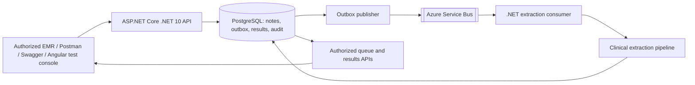
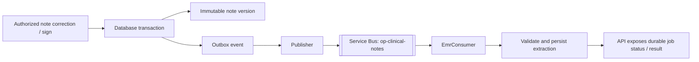
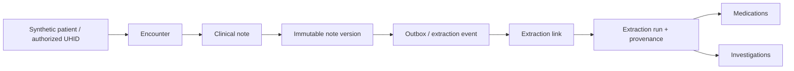
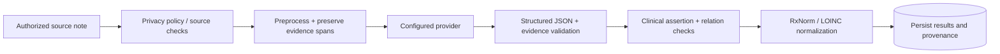
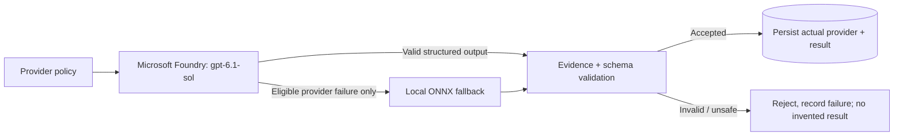
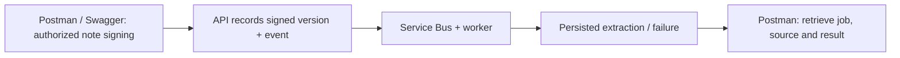
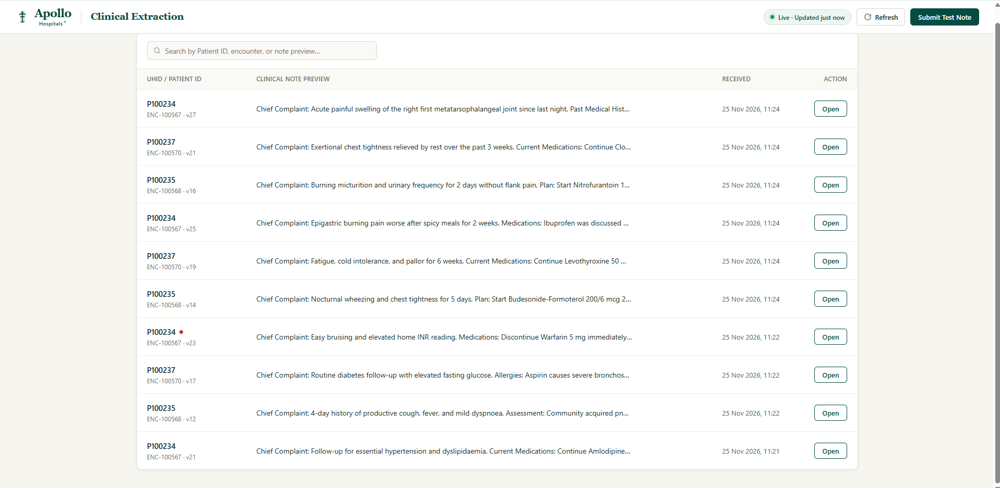
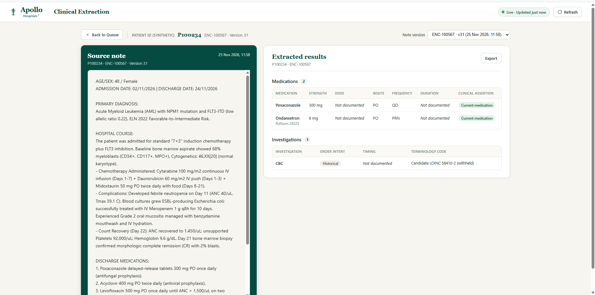

<div align="center">

# Apollo Clinical Extraction Platform

### From unstructured clinical notes to traceable, structured medication and investigation data

**An API-first, event-driven clinical information extraction prototype built with ASP.NET Core, PostgreSQL, Azure Service Bus, Microsoft Foundry and local ONNX inference.**

[](https://dotnet.microsoft.com/)
[](https://angular.dev/)
[](https://www.postgresql.org/)
[](https://learn.microsoft.com/azure/service-bus-messaging/)
[](https://onnxruntime.ai/)
[](#project-status-and-evidence)

[Architecture](#system-architecture) · [Clinical pipeline](#clinical-extraction-pipeline) · [AI providers](#ai-provider-strategy) · [API & Postman](#api-first-integration-and-testing) · [UI gallery](#temporary-testing-console) · [Security](#security-and-privacy) · [Verification](#project-status-and-evidence)

</div>

> [!IMPORTANT]
> **Clinical engineering prototype — not a deployed medical device or approved hospital production system.** Demonstrations and reported tests use synthetic clinical records. Extracted information is **not** independently verified clinical truth and must not automatically create orders or change an EMR. Institutional review, privacy/security assessment, independent clinical validation and deployment authorization remain necessary. The project name and prototype branding do not imply Apollo Hospitals has approved a production deployment.

---

## Why this project exists

Clinical documentation is written for people, not databases. A single note may contain a current medication, a drug allergy, a medication discontinued yesterday, an investigation ordered for next week, and historical laboratory results. Merely recognizing drug or test names is insufficient: the system must determine **what the note actually says**, preserve its supporting evidence, and distinguish missing information from inferred information.

Apollo Clinical Extraction Platform explores a reusable backend service for converting signed clinical free text into structured, auditable **medication mentions and investigation records**. The core application is a **headless ASP.NET Core API and asynchronous worker**. A small Angular console exists for development demonstrations; it is **not** a hospital EMR replacement or a runtime dependency.

### Design principles

| Principle | Engineering decision |
| --- | --- |
| **Backend-first** | Swagger, Postman, a future authorized EMR and the Angular test console consume the same protected REST APIs. |
| **Durable before processing** | Signed note versions and outbox events are stored transactionally before asynchronous publication. |
| **Evidence before confidence** | Extracted entities require source grounding; unproven details remain unresolved rather than being fabricated. |
| **Differentiate clinical assertions** | New, current, historical, discontinued, negated, allergic and conditional mentions are not equivalent. |
| **Explicit model provenance** | Persist the provider and model actually used rather than assuming the configured primary model ran. |
| **Safe failure** | Invalid evidence and prohibited identifiers may block a result; an HTTP 200 from a model does not automatically mean clinical acceptance. |
| **Replaceable test UI** | The Angular queue monitors persisted backend state and can be removed without stopping extraction. |

## What the platform does

- **Clinical note lifecycle.** Stores signed immutable note versions and tracks their asynchronous extraction jobs.
- **Event-driven processing.** Uses a transactional PostgreSQL outbox, Azure Service Bus and a .NET consumer to decouple ingestion from inference.
- **Medication extraction.** Captures names and supported instructions, such as strength, route, frequency, duration and assertion, when substantiated by the text.
- **Investigation extraction.** Identifies laboratory tests, imaging and other investigations with order intent and documented timing when supported.
- **Terminology normalization.** Attempts RxNorm and LOINC mappings; ambiguous or unsupported mappings remain visibly unresolved in structured data.
- **Source-grounded validation.** Checks extracted quotations/evidence against source text and rejects invalid model evidence.
- **Provider routing.** Integrates Microsoft Foundry for structured LLM extraction, with a policy-controlled local ONNX path.
- **Developer verification.** Provides versioned APIs, development Swagger/OpenAPI, Postman CLI collections, xUnit tests and Angular/Playwright acceptance checks.

---

## System architecture

The same ASP.NET Core backend serves both external consumers and the temporary development console.



**Key separation:** the HTTP request acknowledges an accepted, durably recorded note; the AI work runs asynchronously. The browser polls the **API's PostgreSQL-backed worklist**, not the Azure Service Bus queue. A broker queue with no active messages can still have many historical completed extraction records in PostgreSQL.

### Durable asynchronous lifecycle



Processing and publication are separate states. A submitted note may be waiting, published, processing, completed or failed. Retries, duplicate handling and dead-letter outcomes are tracked by backend infrastructure rather than simulated by Angular.

### What is persisted and linked



The queue is **submission/version-centric**, not unique-patient-centric. One synthetic patient can appear several times when different signed note versions have been submitted. Opening an entry must resolve the exact patient, encounter, note version and extraction run; no patient data is selected using the display UHID alone.

---

## Clinical extraction pipeline



Each stage has a different responsibility:

1. **Source integrity.** Bind processing to one immutable note version; keep the source text and extraction identifiers traceable.
2. **Privacy and preprocessing.** Apply the configured policy before inference and preserve the text needed to validate evidence. A verified-synthetic testing exception exists; it is **not** general-purpose automatic de-identification.
3. **Entity extraction.** Identify medication and investigation candidates and their explicitly supported attributes.
4. **Clinical interpretation.** Distinguish instructions from allergies, historical mentions, negative statements and conditional plans.
5. **Validation.** Enforce schema and source-evidence consistency; reject unsafe or unsupported model output.
6. **Normalization.** Resolve terminology when sufficiently specific; otherwise preserve the raw mention and unresolved status.
7. **Persistence.** Save structured entities and provider provenance, linked to the original submission and note version.

### Illustrative structured result

This **conceptual example is not an exact generated API DTO**; consult `/openapi/v1.json` for the running contract.

```json
{
  "sourceNoteId": "synthetic-note-id",
  "noteVersion": 1,
  "processingState": "Completed",
  "providerUsed": "microsoft_foundry",
  "medications": [
    {
      "name": "Amlodipine",
      "strength": "5 mg",
      "frequency": "once daily",
      "assertion": "current_medication",
      "evidence": "Continue amlodipine 5 mg once daily."
    }
  ],
  "investigations": [
    {
      "name": "Complete blood count",
      "intent": "new_order",
      "terminologyStatus": "unresolved",
      "evidence": "Order complete blood count."
    }
  ]
}
```

The exact contract may have additional identifiers, terminology objects, review flags and audit fields. An unresolved code is preferable to an unjustified code assignment.

---

## AI provider strategy

The system distinguishes **configured primary provider**, **provider that actually executed**, and **fallback reason**. These fields should not be inferred from the latest environment settings when viewing older results.



| Aspect | Microsoft Foundry | Local ONNX |
| --- | --- | --- |
| Intended role | Primary structured clinical extractor | Offline/local processing or policy-controlled fallback |
| Runtime | Authorized Azure-hosted model | CPU-compatible local ONNX inference |
| Reported deployment / artifact | `gpt-6.1-sol` deployment; one live response reported `gpt-6.1-sol-2026-09-29` | `bc5cdr_int8` via `onnx_neurosymbolic_int8` adapter |
| Strength | Structured extraction across medication and investigation scenarios in controlled synthetic tests | Local inference without a Foundry network request |
| Limitation | May generate invalid source-evidence spans; paid usage; must be validated | BC5CDR primarily recognizes chemicals/diseases, not complete prescription attributes or investigations |
| Release posture | Validate every result and control billing | Do not assume GPT-equivalent coverage or calibrated confidence |

**Local ONNX accuracy is an active engineering limitation.** Prior code inspection identified a restrictive prescription-prefix gate, a small medication dictionary, dictionary-only investigation matching, and shallow temporal rules. In an AML discharge-summary test, these conditions reportedly filtered out multiple genuine medication mentions and misclassified a future CBC. A broader local extraction redesign and independently adjudicated evaluation have been **proposed**, not established as completed.

### Live Foundry test snapshot — 25 November 2026

A development report describes **10 sequential live paid Foundry attempts** through the signed-note → outbox → Azure Service Bus → .NET consumer workflow:

| Observation | Reported evidence |
| --- | --- |
| Live model calls | **10 attempted** |
| Results accepted and persisted | **9 / 10** |
| Rejected by clinical evidence guard | **1 / 10** — `AZURE_INVALID_EVIDENCE` |
| Local ONNX fallback in that controlled batch | **Disabled** |
| Recorded tokens | **12,964** across the nine persisted runs (8,578 input; 4,386 output) |
| Outcome interpretation | **90% accepted/persisted**, **not 90% clinical accuracy** |

The rejected run demonstrates that a successful model HTTP response may still fail evidence validation. The report's clinical accuracy figures, if cited elsewhere, must be interpreted in the context of small synthetic evaluation sets rather than generalized to clinical deployment.

**Evidence reference:** [`docs/APOLLO_LIVE_FOUNDRY_10_EXTRACTIONS_REPORT.md`](docs/APOLLO_LIVE_FOUNDRY_10_EXTRACTIONS_REPORT.md) and [`docs/foundry-live-10-evidence/live-foundry-10-results.json`](docs/foundry-live-10-evidence/live-foundry-10-results.json), where present in the checked-out repository. Verify that evidence artifacts are synthetic and safe to publish.

---

## API-first integration and testing

**The backend must operate without Angular.** Postman CLI and Swagger interact with the same API used by the test console. Authentication and note/encounter access rules remain enforced on the server.

### Confirmed route families from development reports

| HTTP | Route | Purpose |
| --- | --- | --- |
| `GET` | `/health` | JSON application liveness |
| `GET` | `/health/db` | PostgreSQL readiness |
| `GET` | `/health/ready` | Aggregated dependency readiness |
| `GET` | `/openapi/v1.json` | Development OpenAPI specification |
| `GET` | `/swagger` | Development interactive API documentation |
| `GET` | `/api/v1/queue?limit=5` or `?limit=10` | Paginated extraction submission worklist |
| `GET` | `/api/v1/queue/{noteId}?version=...&patient=...` | Patient/version-scoped extraction details |
| `GET` | `/api/v1/queue/patients/{patientReference}` | Authorized within-patient note/version selection |
| `POST` | `/api/v1/emr/notes/{id}/corrections` | Existing authorized note correction/version workflow |
| `POST` | `/api/v1/emr/notes/{id}/sign` | Finalize/sign note and trigger outbox processing |

Route availability and authentication requirements depend on the deployed host configuration. Treat the **generated OpenAPI document and live source code** as authoritative. Do not copy synthetic-development authentication into a production integration.

### Backend-only local development (Windows)

The commands below are intended for an **already configured development environment**, with PostgreSQL, Azure credentials/messaging and model artifacts provisioned according to the repository's setup documentation.

```powershell
# From the repository root
cd "D:\AI Extraction"

# Keep the API host running in a dedicated terminal.
# Its hosted services may include outbox publication and message consumption.
dotnet run --project .\backend\Apollo.Backend.csproj --urls "http://127.0.0.1:5000"
```

In a separate terminal:

```powershell
# Check the API before running the collection
Invoke-RestMethod http://127.0.0.1:5000/health

# Execute the versioned Postman CLI suite against the running host
.\Run-Apollo-Postman-Tests.ps1
```

Or use the repository's opt-in test-runner startup mode:

```powershell
.\Run-Apollo-Postman-Tests.ps1 -StartBackend
```

The `-StartBackend` mode is a **test harness**; it may stop the server it starts after execution. To keep Swagger open, run the host in a persistent terminal instead. The actual runner behavior is defined by the script.

### Development test console (optional)

```powershell
cd "D:\AI Extraction\frontend"
npm ci
npm start
```

Open `http://localhost:4200/` if the Angular development server is configured to use its usual port. The browser is not required for API ingestion, queue publication, worker execution or results retrieval. The repository also contains `Start-Apollo.bat` / `Start-Apollo.ps1` for the fuller local experience; inspect script prerequisites before using them.

### Postman workflow



The collection should verify transport reachability, authentication, ingestion, job completion, source/result identity, terminology status, provider provenance, negative access cases and idempotency. **Offline provider stubs and live Azure integration tests must be reported separately.**

---

## Temporary testing console

The Angular 21 application is a **single-screen developer queue** with a side-by-side clinical note viewer. It replaces the earlier doctor portal/dashboard experience in the active frontend.

- **Queue:** newest submitted extraction events; repeated patient IDs are allowed when note versions differ.
- **Show entries:** compact `5` / `10` dropdown (default `10`).
- **Search and polling:** backend-backed search and approximately four-second live refresh in the reported development build.
- **Detail:** exact patient / encounter / note-version source on the left and associated medication/investigation output on the right.
- **Safety:** API authorization and request-identity checks prevent switching patients from displaying stale cross-patient results.
- **Presentation:** no doctor dashboard, status-filter bar, validation-warning wall or review/approval workflow in the active test console.

### Queue overview



*Latest submitted note versions are displayed individually, including multiple versions belonging to the same synthetic patient.*

### Note and extraction comparison



*The source note remains available next to extracted structured records. The screenshot is a historical synthetic demonstration and does not establish extraction completeness.*

> [!NOTE]
> A compact **actual-provider indicator** has been requested for the detail view, distinguishing successful Foundry extraction, direct Local ONNX execution and genuine ONNX fallback. Its presence in the currently deployed UI must be verified against both the Angular template and persisted extraction metadata; do not infer it from these older screenshots.

---

## Security and privacy

Privacy controls apply to the **backend**, not only to the visible user interface.

- **Authorized clinical resources.** The API restricts access to appropriate patient, encounter and note-version scopes; synthetic demo UI navigation does not authorize arbitrary cross-patient retrieval.
- **Immutable provenance.** Signed note versions, outbox events and extraction links are verified before processing.
- **Identifier gating.** `ZeroLeakageValidator` detects defined identifier categories and can block unsafe inference with `SOURCE_REQUIRES_PRIVACY_REVIEW`.
- **Development-only synthetic policy.** A reported implementation authorizes a small, trusted set of synthetic development records after backend-side provenance checks. This is **not** a general PHI bypass and is disabled outside its explicit development guardrails.
- **Clinical grounding.** `AZURE_INVALID_EVIDENCE` remains a rejection condition rather than being silently converted into a successful extraction.
- **Secrets and telemetry.** Azure credentials, model keys and clinical identifiers must not be committed or exposed through application logs, screenshots or README examples.

**Important distinction:** the verified-synthetic exception passes original synthetic source text to an allowed provider. It does **not** mean that automatic general-purpose de-identification, residual-PII risk assessment and source-to-redacted span mapping have been implemented. Those remain separate privacy engineering work before broad real-world clinical use.

---

## Repository guide

The paths below reflect the project layout reported during development. Verify against the current checked-out branch before publishing this tree as exhaustive.

```text
Apollo-Clinical-Extraction/
├── backend/
│   ├── Apollo.Backend.csproj
│   ├── Program.cs
│   ├── Clinical/                   # extraction workflow, providers, validation
│   ├── Emr/                        # note versions, outbox, queue and worker
│   ├── Security/                   # privacy and authorization policy
│   ├── Configuration/              # readiness and OpenAPI wiring
│   ├── db/platform/migrations/     # PostgreSQL schema evolution
│   ├── artifacts/                  # local model resources (respect .gitignore)
│   └── tests/                      # xUnit / integration test projects
├── frontend/
│   ├── src/app/queue/             # Angular queue, API client and view
│   └── e2e/                       # Playwright test scripts
├── postman/
│   ├── Apollo-Clinical-Extraction.postman_collection.json
│   └── Apollo-Local.postman_environment.json
├── docs/                         # architecture, testing and audit reports
│   └── readme/                    # public-safe synthetic UI screenshots
├── Run-Apollo-Postman-Tests.ps1
├── Run-Apollo-Postman-Tests.bat
├── Start-Apollo.ps1
├── Start-Apollo.bat
└── README.md
```

### Deeper technical documentation

- [Backend-only execution](docs/APOLLO_BACKEND_ONLY_VERIFICATION.md)
- [Postman setup](docs/APOLLO_POSTMAN_CLI_SETUP.md)
- [API contracts](docs/APOLLO_POSTMAN_API_CONTRACTS.md)
- [Postman test evidence](docs/APOLLO_POSTMAN_TEST_RESULTS.md)
- [Synthetic data privacy gate](docs/APOLLO_SYNTHETIC_DATA_PRIVACY_GATE.md)
- [Live Foundry ten-case report](docs/APOLLO_LIVE_FOUNDRY_10_EXTRACTIONS_REPORT.md)

If older documentation describes the retired doctor dashboard or approval UI, treat it as **historical implementation evidence**, not the current frontend specification.

---

## Project status and evidence

The following are **reported development test snapshots**, not continuously running CI badges. Results from different stages should not be interpreted as a single unified current test run.

| Test / milestone | Reported result | Scope and qualification |
| --- | --- | --- |
| Backend-only Postman CLI | **36/36 requests, 41/41 assertions passed** | Local ONNX / existing API integration; Angular stopped |
| UHID-scoped queue work | **77/77 selected backend tests** | Selected isolation, routing and offline contract suites at that stage |
| Queue page-size enhancement | **54/54 Angular tests, 6/6 Playwright checks** | 5/10 entry selection, polling and version-aware UI behavior |
| Synthetic identifier privacy exception | **21/21 selected backend tests** | Real test PostgreSQL plus offline Foundry stubs; distinct from general de-identification |
| Controlled live Microsoft Foundry batch | **9/10 accepted and persisted** | Ten synthetic paid calls; one rejected by evidence guard; not a measure of clinical accuracy |
| Complex AML note with legacy Local ONNX | **Demonstrated partial extraction** | Correctness and completeness concerns remain; broader benchmark required |
| Institutional production readiness | **Not established** | Formal clinical, privacy, security, operational and governance assessments outstanding |

### Known limitations and active engineering work

1. **Local ONNX completeness.** The BC5CDR-based pathway lacks dedicated investigation NER and may discard valid medication mentions through narrow rules. The proposed Stage 15 modular local extraction overhaul should be validated before any improved-accuracy claim.
2. **Clinical evidence reliability.** At least one live Foundry result failed strict evidence validation. Rejection is preferable to storing an unsupported result; forensic remediation requires reproducible offline tests.
3. **Terminology ambiguity.** A recognized investigation does not always justify one precise LOINC code; unresolved mappings remain legitimate output states.
4. **Privacy readiness.** A trusted synthetic-data development exception is present in the reported build. General automatic de-identification and protected offset remapping are not yet demonstrated.
5. **Clinical evaluation.** Processing pass rates and small synthetic benchmarks are not substitutes for independently reviewed precision, recall, assertion accuracy, calibration and prospective clinical validation.

---

## Roadmap

- [x] API-first backend and versioned clinical note ingestion
- [x] PostgreSQL transactional outbox and Azure Service Bus worker integration (reported tests)
- [x] Structured Foundry integration and controlled live synthetic calls
- [x] Local ONNX pipeline for offline tests and constrained fallback
- [x] PostgreSQL-backed queue, repeated note versions, search and 5/10 selector
- [x] Postman CLI, development Swagger and backend-only verification
- [x] Restricted verified-synthetic privacy testing policy
- [ ] Fully benchmark and improve local medication/investigation extraction
- [ ] Independently adjudicate broader clinical evaluation datasets
- [ ] Demonstrate general automatic de-identification with evidence-offset mapping
- [ ] Verify historical actual-provider badges across both model paths
- [ ] Complete institutional privacy/security, clinical and operational release gates

## Engineering and responsible use

This repository is intended for research, systems engineering and synthetic-data verification. No inference result should be treated as a prescription, clinical decision or authorization to modify a patient record. Keep sample data synthetic; do not upload patient-identifiable notes, credentials, unredacted logs or institution-sensitive infrastructure information to a public repository.

**License:** see the repository's existing `LICENSE` file, if present. This README does not assert an unverified license.

---

<div align="center">

**Clinical information extraction should be measurable, evidence-grounded and safe to inspect — even when a model is uncertain.**

</div>
