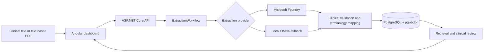

Apollo Clinical Extraction Platform
A source-grounded clinical information extraction platform for converting unstructured medical notes and text-based PDFs into structured, reviewable data.

Built with Angular, ASP.NET Core (.NET 10), Microsoft Foundry, a local ONNX fallback, and PostgreSQL with pgvector, the platform brings clinical text ingestion, AI-assisted extraction, terminology normalization, validation, and human review into a single workflow.
Project status: Engineering and local demonstration platform. Clinical accuracy and safety have not been independently validated for hospital production use. Do not use with real patient data without institutional authorization, appropriate security controls, and clinical governance approval.

Overview
Clinical notes frequently contain medications, allergies, investigations, dosing instructions, and historical findings in free-text form. Apollo Clinical Extraction helps turn that information into structured records while retaining source context and making uncertainty visible for review.

Key capabilities
- Two input modes: Paste clinical text or upload a text-based PDF. Both use the backend ExtractionWorkflow.
- Hybrid extraction: Microsoft Foundry is the primary extraction provider, with a local ONNX-based fallback. Model-derived spans and rule-derived attributes should be interpreted separately.
- Clinical structuring: Identify medications and investigations, with supporting attributes and source evidence where available.
- Terminology mapping: Resolve applicable concepts against RxNorm and LOINC, preserving ambiguous or unresolved results instead of forcing a code.
- Validation and review: Apply clinical validation and expose extracted entities for human review with a separate audit trail.
- Persistent results: Store extraction data in PostgreSQL. The API reports saved: true only after PostgreSQL successfully persists the result.
- Interoperability: Expose extraction APIs alongside existing compatibility endpoints and FHIR-related capabilities.
PDF limitation: Image-only or scanned PDFs are not OCR-processed by this repository. They return 422 OCR_REQUIRED because OCR is not bundled.
Architecture

The ONNX fallback is not a drop-in equivalent to a general-purpose clinical LLM: medication/condition mention detection and deterministic C# attribute processing have different capabilities. Extraction results require human verification, particularly for ambiguous instructions and safety-relevant findings.
Technology stack
Layer	Technology
Frontend	Angular, TypeScript
Backend	ASP.NET Core, .NET 10, C#
Primary extraction	Microsoft Foundry (gpt-6.1-sol development deployment)
Local fallback	INT8 ONNX clinical entity extraction with C# post-processing
Data storage	PostgreSQL with the vector extension
Terminology	RxNorm and LOINC
Testing	.NET tests, Angular tests, browser end-to-end tests
Local database setup	Docker Compose

Python is not required for the application runtime or build.
Repository structure
.
├── frontend/                         # Angular clinical extraction dashboard
├── backend/
│   ├── Apollo.Backend.csproj          # ASP.NET Core API
│   ├── Clinical/                      # Extraction and clinical processing
│   ├── Storage/                       # PostgreSQL persistence
│   ├── db/platform/migrations/        # Versioned database migrations
│   ├── infra/docker/                  # Local Docker configuration
│   ├── contracts/                     # API/data contracts
│   ├── docs/                          # Backend technical documentation
│   └── tests/                         # .NET test projects
└── AIExtraction.slnx                  # .NET solution
For a more detailed directory guide, see [Repository structure](backend/docs/repository-structure.md).
Getting started
Prerequisites
- .NET 10 SDK
- Node.js 24+ and npm
- PostgreSQL with the vector extension, or Docker and Docker Compose for the supplied database setup
- Azure CLI sign-in for the documented local Microsoft Foundry authentication workflow, if using that provider
1. Start PostgreSQL
From the repository root:
docker compose -f backend/infra/docker/docker-compose.yml up -d
The database connection can be overridden with the ConnectionStrings__Postgres environment variable. On an existing database, review and apply required migrations from backend/db/platform/migrations/ in version order before starting an upgraded application. Do not reset an existing database as part of an ordinary upgrade.
2. Start the API
dotnet run --project backend/Apollo.Backend.csproj
For Microsoft Foundry development, follow the [Foundry configuration and integration guide](backend/docs/foundry-integration.md). The documented development deployment is gpt-6.1-sol.
3. Start the frontend
In another terminal:
cd frontend
npm ci
npm start
Open http://localhost:4200.

The Angular development server proxies /api, /v1, /predict, and /health to the API at http://127.0.0.1:5000. When a production Angular build exists at frontend/dist/cx-review-ui/browser, the backend can serve it directly.
API overview
Endpoint	Purpose
POST /api/v1/extractions	Extract structured data from clinical text
POST /api/v1/extractions/pdf	Extract structured data from a text-based PDF
GET /api/v1/extractions/{id}	Retrieve a persisted extraction
/v1/ner/predict	Legacy NER compatibility endpoint

The API also retains documented PDF aliases for compatibility. See the backend documentation for request/response contracts, review operations, and provider configuration.
Run verification checks
From the repository root:
# Backend restore, build, and tests
dotnet restore AIExtraction.slnx
dotnet build AIExtraction.slnx --configuration Release
dotnet test backend/tests/Apollo.Backend.Tests.csproj --configuration Release

# Frontend dependencies, unit tests, and production build
npm --prefix frontend ci
npm --prefix frontend test -- --watch=false
npm --prefix frontend run build
Some integration or live-provider tests require separate services, configuration, or explicit authorization. A passing local test suite is not evidence of independent clinical validation.
Configuration and security
- Never commit secrets: Store provider API keys in .NET User Secrets or environment variables, not source code or Angular configuration.
- Use identity-based access: Local development can use Azure CLI credentials; deployed Azure services should use appropriately configured Entra ID or managed identity credentials.
- Protect clinical information: Use synthetic data for demonstrations. Review authentication, access control, database transport security, audit retention, and institutional requirements before handling real patient records.
- Review model output: Extracted content and terminology codes may be incomplete or incorrect. Human clinical review remains necessary.
Documentation
- [Microsoft Foundry integration, configuration, migrations, verification, and handoff](backend/docs/foundry-integration.md)
- [Repository structure](backend/docs/repository-structure.md)
- [Build status](backend/docs/BUILD_STATUS.md)
- [Architecture documentation and ADR index](backend/docs/00-index.md)
Apollo Clinical Extraction Platform — a modular foundation for source-grounded clinical information extraction, transparent model provenance, structured persistence, and human review.
