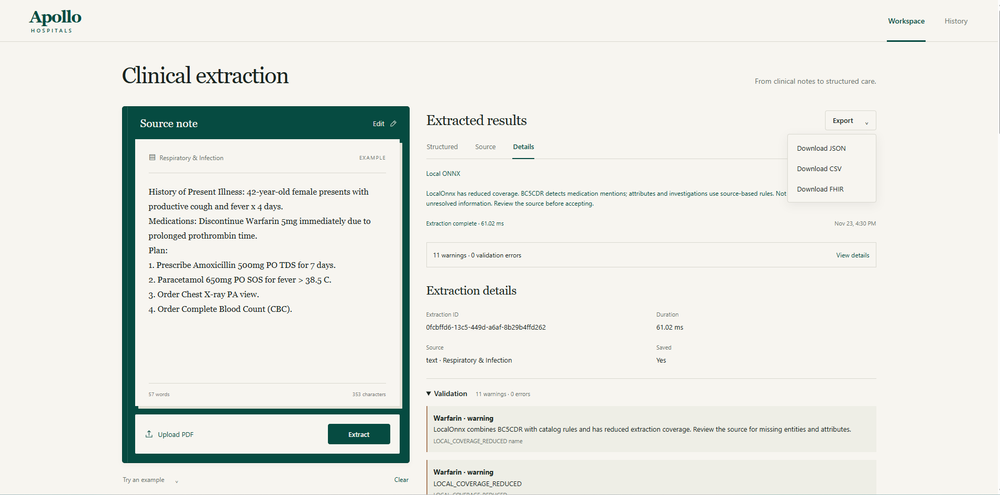
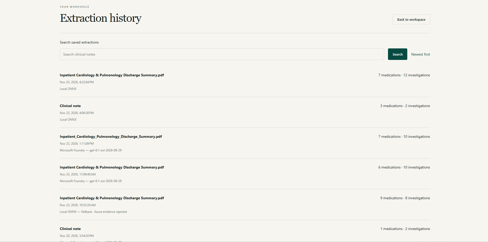
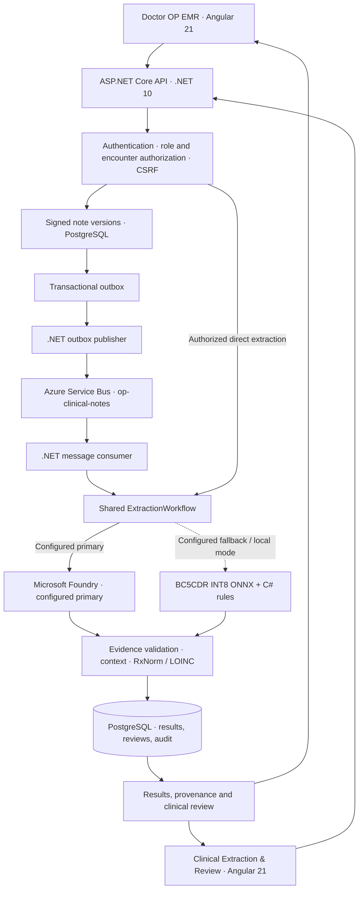
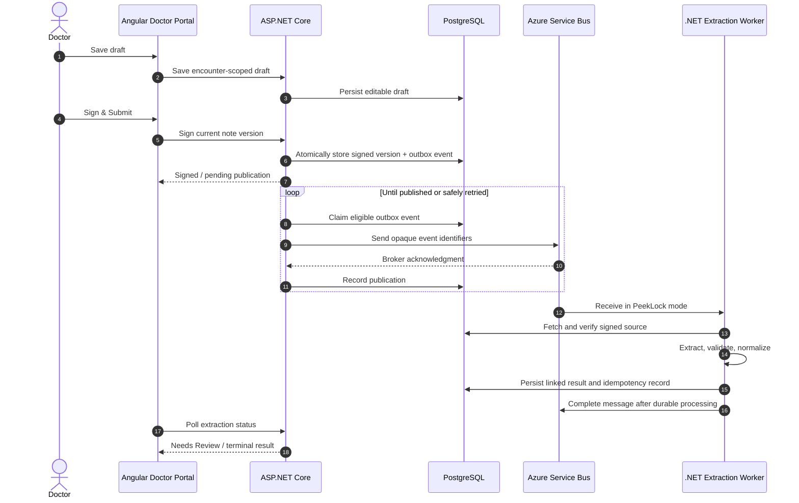

<div align="center">

# Apollo Clinical Extraction Platform

### Evidence-grounded clinical information extraction, from outpatient documentation to structured review.

**A full-stack clinical AI engineering prototype** combining a doctor-facing outpatient EMR, asynchronous event processing, hybrid model inference, terminology normalization, and auditable human review.

[](https://dotnet.microsoft.com/)
[](https://angular.dev/)
[](https://www.postgresql.org/)
[](https://learn.microsoft.com/azure/service-bus-messaging/)
[](#project-status)

[**Experience the interface**](#interface-gallery) · [**Explore the architecture**](#system-architecture) · [**Get started**](#getting-started) · [**Review the API**](#api--integration) · [**Engineering evidence**](#verification--evidence)

</div>


## Overview

Clinical notes frequently contain overlapping medication instructions, historical diagnoses, test orders, negations, and conditional plans. Converting these narratives into trustworthy structured records requires more than identifying medical terms: each output needs **source evidence, clinical context, terminology scrutiny, and a human-review path**.

Apollo Clinical Extraction Platform addresses that workflow through two complementary entry points:

| Experience | What it enables | Processing model |
| --- | --- | --- |
| **Doctor OP EMR** | Sign in, view assigned outpatient encounters, write or revise drafts, and sign immutable clinical note versions. | **Asynchronous:** PostgreSQL transactional outbox → Azure Service Bus → .NET worker → extraction → review. |
| **Clinical Extraction & Review** | Submit authorized text/PDF requests, inspect extracted entities and source evidence, resolve uncertainties, and access saved results. | **Direct API:** authenticated extraction request → shared extraction workflow → persistence → review. |

The **Doctor** and **ClinicalReviewer/Admin** access paths are intentionally distinct. A successful doctor login does not automatically authorize direct extraction API calls; the server's actual role, encounter-scoping, and anti-forgery policies govern access.

### At a glance

- **Evidence-first extraction:** medications, allergies, investigations, order intent, and documented attributes with source-grounding checks.
- **Hybrid providers:** Microsoft Foundry `gpt-6.1-sol` integration and an offline BC5CDR INT8 ONNX/C# pipeline, with explicit provider provenance.
- **Clinical terminology:** RxNorm and LOINC resolution with unresolved or ambiguous mappings retained for review.
- **Durable asynchronous ingestion:** signed notes become immutable versions and are published through a transactional outbox.
- **Real queue integration:** Microsoft Entra ID-based Azure Service Bus publisher/consumer, retries, duplicate detection, and idempotent handling.
- **Human-in-the-loop:** review decisions, source quotations, warnings, persisted results, and audit history.

## Project status

**Development snapshot: 24 November 2026.** The table distinguishes exercised engineering paths from remaining work; test success is **not** clinical validation.

| Area | Engineering status | Qualification |
| --- | --- | --- |
| Doctor sign-in, assigned encounters, note drafts, signing | **Implemented; browser acceptance reported** | Uses synthetic local demonstration identities and encounter data. |
| Signed-note transactional outbox | **Implemented; recovery tested** | Previously pending outbox events were recovered following a backend configuration/restart correction. |
| Live Azure Service Bus send → receive → complete | **Live integration test reported passing** | Tested with synthetic events, Microsoft Entra ID, and no shared access keys. |
| Doctor note → queue → worker → local extraction → results | **Stage 9.2 browser acceptance reported passing** | Local ONNX path; human review remains necessary. |
| Microsoft Foundry primary model | **Integrated; controlled live verification documented** | Not the provider used for Stage 9.2's zero-cost browser acceptance. |
| Direct `POST /api/v1/extractions` from Doctor session | **Known access issue under investigation** | The Doctor session has returned **HTTP 403**. Authorization/CSRF policy must be diagnosed, not bypassed. |
| Independent clinical validation and production readiness | **Not complete** | No claims of clinical-grade accuracy, regulatory clearance, or deployment approval. |

See [Verification & evidence](#verification--evidence) for the supporting development reports.

## Interface gallery

Screenshots below are from **synthetic development scenarios**, not real patient records. The first gallery uses the existing screenshot assets maintained in `docs/screenshots/`.

### Clinical extraction workspace

[](docs/screenshots/02-extraction-results.png)

*Source content and structured results shown together, with model provenance and reduced-coverage disclosure when the offline fallback is selected.*

<table>
  <tr>
    <td width="50%" valign="top"><a href="docs/screenshots/01-workspace-input.png"></a><br/><strong>01 · Clinical input</strong><br/>Pasted clinical notes and supported text PDFs.</td>
    <td width="50%" valign="top"><a href="docs/screenshots/03-pdf-extraction.png"></a><br/><strong>02 · PDF extraction</strong><br/>Text-based PDF processing with structured output.</td>
  </tr>
  <tr>
    <td width="50%" valign="top"><a href="docs/screenshots/04-validation-export.png"></a><br/><strong>03 · Validation and export</strong><br/>Evidence, warnings, metadata, and supported exports.</td>
    <td width="50%" valign="top"><a href="docs/screenshots/05-extraction-history.png"></a><br/><strong>04 · Extraction history</strong><br/>Persisted runs with provider and review context.</td>
  </tr>
</table>

### Doctor OP EMR

The Stage 9.2 acceptance run also captured the doctor login, dashboard, note editor, draft save, sign confirmation, extraction status, and results review. Those locally generated captures are documented in [`docs/APOLLO_STAGE9_2_OUTBOX_RECOVERY_AND_ACCEPTANCE_REPORT.md`](docs/APOLLO_STAGE9_2_OUTBOX_RECOVERY_AND_ACCEPTANCE_REPORT.md). Review the files under `docs/stage9-evidence/playwright/stage9-2/screenshots/` before publishing additional images to a public repository; verify that they contain synthetic information only.

## System architecture



The signed-note path is **asynchronous**: saving a signed note is not dependent on instantaneous availability of the cloud queue. Outbox entries are retried by the publisher, and message processing uses idempotency safeguards to avoid duplicate downstream work.

**Provider boundary:** BC5CDR is a biomedical entity-recognition model, not a general-purpose clinical language model. The local fallback combines ONNX detections with deterministic C# attribute and investigation logic, and may produce narrower coverage than the cloud provider. UI and API responses should identify the provider actually used.

## Clinical extraction lifecycle



Only **opaque event/note references** should traverse the queue; clinical note content stays within protected application storage. An acknowledgment from Azure proves message delivery, not extraction correctness. The result must remain inspectable and reviewable by an appropriately authorized user.

### Clinical interpretation and terminology

The validation layer is designed to distinguish:

| Source statement | Intended treatment |
| --- | --- |
| “Start paracetamol 500 mg orally twice daily for 3 days.” | New medication order with supported attributes. |
| “Penicillin causes anaphylaxis.” | Allergy; **not** an active prescription. |
| “CBC was normal last week.” | Historical investigation/result; **not** a new order. |
| “Order a chest X-ray if symptoms persist.” | Conditional investigation, not an unconditional order. |
| “Amoxicillin was discussed but not prescribed.” | Explicitly **not** a prescription. |

RxNorm/LOINC matches should preserve clinical meaning, formulation, strength, route, specimen, and uncertainty; unavailable or ambiguous codes must remain unresolved rather than fabricated. Source quotations and offsets support review but do not replace clinician judgment.

## Technology stack

| Concern | Implementation |
| --- | --- |
| Web application | Angular 21, TypeScript, component-level UI and browser tests |
| Backend | ASP.NET Core / .NET 10, C# REST API and background hosted services |
| Identity and access | Cookie-based local development authentication, role checks, encounter-scoped authorization, CSRF defenses |
| Cloud messaging | Azure Service Bus Standard, `Azure.Messaging.ServiceBus`, `Azure.Identity`, Microsoft Entra ID RBAC |
| Primary inference | Microsoft Foundry (`gpt-6.1-sol` deployment, when explicitly configured and authorized) |
| Local inference | BC5CDR INT8 ONNX with deterministic C# extraction/validation logic |
| Persistence | PostgreSQL, `pgvector`, transactional outbox, versioned notes, review/audit records |
| Terminology | RxNorm and LOINC mapping with unresolved-candidate handling |
| Testing | xUnit, Angular unit tests, Playwright Chromium E2E, isolated database tests |

## Repository structure

```text
Apollo-Clinical-Extraction/
├── frontend/                            Angular UI and Playwright flows
│   └── e2e/                             Browser acceptance tests
├── backend/
│   ├── Apollo.Backend.csproj             .NET API and hosted services
│   ├── Emr/                             Doctor, notes, messaging and worker
│   ├── Clinical/                        Extraction and clinical validation
│   ├── Storage/                         PostgreSQL repositories
│   ├── Configuration/                   Local development configuration
│   ├── db/platform/migrations/          Versioned database schema
│   ├── infra/docker/                   Optional local infrastructure
│   └── tests/                           Backend and integration suites
├── docs/
│   ├── screenshots/                     Clinical extraction UI gallery
│   └── stage9-evidence/                EMR and messaging test evidence
├── Start-Apollo.bat                     Windows launcher
├── Start-Apollo.ps1                     Service orchestration
└── AIExtraction.slnx                    Solution file
```

Directory availability may vary between development branches and release packages. Generated evidence and local database files are **not** prerequisites for cloning and building the source.

## Getting started

### Prerequisites

- **.NET 10 SDK**
- **Node.js 24+** and npm
- **PostgreSQL** with the required schema and `vector` extension, or the project-provided Docker Compose setup
- **Microsoft Entra ID / Azure access** only when testing real Azure Service Bus or Microsoft Foundry
- A **synthetic local doctor account** initialized through the backend's approved development seeding flow

> [!CAUTION]
> Do not store passwords, API keys, bearer tokens, real patient data, or reusable demo credentials in this README or a public Git commit. Keep local `.env` and user secrets untracked. Demo passwords must be established or rotated locally.

### Option A — Windows development launcher

For a **previously provisioned development machine**, start the application from the repository root:

```powershell
.\Start-Apollo.bat
```

The launcher orchestrates the local PostgreSQL service (where bundled), ASP.NET Core backend and Angular frontend. Open **http://localhost:4200/login** for the Doctor OP EMR, or **http://localhost:4200** for the application entry point.

The launcher does **not** provision PostgreSQL on a fresh clone. In this repository's pre-provisioned Windows configuration, it expects bundled binaries under `backend/tools/pgsql/` and an existing cluster under `backend/tools/data_cx/`; those machine-local artifacts should not be committed. Check ports **5432**, **5000**, and **4200**, and ensure any already-running process is the correct application version. **Restart the backend after changing messaging configuration**: background workers evaluate their startup configuration when the host starts.

### Option B — Run components separately

From the repository root, start the optional Compose-backed database if it is present:

```powershell
docker compose -f backend/infra/docker/docker-compose.yml up -d
```

Apply database migrations in order using the repository's documented migration process; back up existing data and **do not** reinitialize a database containing clinical extraction history.

Start the API:

```powershell
dotnet restore AIExtraction.slnx
dotnet run --project backend/Apollo.Backend.csproj
```

Start the frontend in another terminal:

```powershell
cd frontend
npm ci
npm start
```

The Angular development server is at **http://localhost:4200** and proxies API requests to the local backend on port **5000**.

### Azure Service Bus (opt-in, local development)

The verified development target is:

| Setting | Value |
| --- | --- |
| Namespace | `apollo-clinical-sb-dev.servicebus.windows.net` |
| Queue | `op-clinical-notes` |
| Region | South India |
| Authentication | Microsoft Entra ID (`DefaultAzureCredential`, with Azure CLI during local development) |
| Assigned development roles | Azure Service Bus Data Sender / Data Receiver |

These resource names are **development-environment examples**, not portable defaults for every deployment. Supply the namespace and queue via the application's configuration mechanism (see [`docs/APOLLO_STAGE9_SERVICE_BUS_SETUP.md`](docs/APOLLO_STAGE9_SERVICE_BUS_SETUP.md)); use an account with the least privileges needed. The local runtime has used `Emr:Messaging:Mode = AzureServiceBus`, while `Extraction:Provider = LocalOnnx` supported a zero-cost Stage 9.2 acceptance test. Do not turn on billable Foundry inference implicitly.

```powershell
# Verify the signed-in account and selected subscription (requires Azure CLI)
az account show --output table

# Inspect the development queue configuration; management access may be required
az servicebus queue show `
  --resource-group rg-935125-9860 `
  --namespace-name apollo-clinical-sb-dev `
  --name op-clinical-notes `
  --query "{name:name,status:status,count:countDetails}" `
  --output json
```

**Queue visibility is not proof of runtime delivery.** Confirm a synthetic message can be sent, received, processed, and settled in the actual running application, and inspect the outbox and worker logs.

## API & integration

Selected API surfaces (refer to backend contracts for exact schemas and access rules):

| Endpoint / area | Purpose | Access note |
| --- | --- | --- |
| `POST /api/v1/extractions` | Direct clinical-text extraction | Subject to endpoint authorization and anti-forgery requirements; currently reported **403 from the Doctor UI**. |
| `POST /api/v1/extractions/pdf` | Text-based PDF extraction | Does not perform OCR of scanned/image-only PDFs. |
| `GET /api/v1/extractions/{id}` | Retrieve stored extraction | Scoped to applicable access controls. |
| `GET /api/v1/extractions/{id}/reviews` | Retrieve review history | Requires appropriate permissions. |
| `POST /api/v1/extractions/{id}/reviews` | Record entity review decision | Requires appropriate permissions and request validation. |
| `/api/v1/emr/...` | Doctor authentication, encounters, notes and extraction status | Use documented route contracts and a valid encounter-scoped session. |
| `/v1/ner/predict` | Legacy NER compatibility | Not the preferred signed-note workflow. |

**PDF support:** text-based PDFs are supported. Scanned or image-only PDFs return `422 OCR_REQUIRED`; no OCR engine is bundled.

### Security model

- Authentication alone does **not** authorize every endpoint. Respect Doctor, ClinicalReviewer and Admin role boundaries, as well as encounter ownership.
- The API must validate anti-forgery tokens on applicable cookie-authenticated state-changing requests.
- Signed note versions must be immutable; draft updates must honor concurrency/version checks.
- Queue messages should carry identifiers, not full clinical documents.
- Preserve original extraction output separately from review corrections and maintain a queryable audit trail.
- Do not log credential material, bearer tokens, authorization headers, or sensitive clinical payloads.

## Testing

```powershell
# Backend build and automated tests
dotnet build AIExtraction.slnx --configuration Release
dotnet test backend/tests/Apollo.Backend.Tests.csproj --configuration Release

# Frontend tests and production build
npm --prefix frontend ci
npm --prefix frontend test -- --watch=false
npm --prefix frontend run build
```

Some tests require a configured PostgreSQL instance, isolated test database, authenticated fixture, or explicit live-cloud opt-in. Never run mutation-capable integration tests against historical production-like data. Keep real Azure and billable model tests separate from routine offline regression suites.

### Selected engineering evidence

The November 2026 development reports document:

- **Stage 9:** 10 EMR integration tests, 42 frontend tests, and five captured browser screens in the initial portal implementation.
- **Stage 9.1:** one synthetic real Azure Service Bus send/receive/complete smoke test; queue reported empty afterward.
- **Stage 9.2:** browser acceptance for doctor login, draft, signing, outbox publishing, Azure worker processing, and results rendering; recovery of two previously pending notes.
- **Model verification:** a separately authorized, controlled Foundry call on a synthetic PDF fixture, with subsequent validator corrections and offline replay validation.

These are **developer-generated engineering artifacts**, not independent clinical sensitivity/specificity estimates, security certifications, or performance SLAs.

## Troubleshooting

| Symptom | Where to investigate | Avoid |
| --- | --- | --- |
| Doctor login fails | Seeded demo identity, session cookie, backend auth logs and correct `/login` route. | Using real institutional credentials in local demo mode. |
| `POST /api/v1/extractions` returns **403 Forbidden** | Response body, Doctor vs reviewer role, CSRF token, server authorization policies, Angular request interceptor. | Disabling authorization or granting Admin privileges as a workaround. |
| Signed note stuck at **Pending Publication** | `emr_outbox_events`, background service registration, broker mode, Azure CLI credential discovery and backend restart. | Re-signing the same note or manually deleting outbox rows. |
| Status remains at **Processing** | Worker logs, processing attempts, provider configuration, database link and queue dead-letter count. | Treating broker delivery as proof of model success. |
| Image-only PDF rejected | `422 OCR_REQUIRED`; submit a text-searchable PDF. | Claiming OCR exists when it is not installed. |
| Model output appears incomplete | Provider provenance, evidence spans, unresolved terminology, ONNX limitations and review decisions. | Presenting unchecked extraction as clinical advice. |

Use **Chrome DevTools → Network → Fetch/XHR** to inspect request method, status, and sanitized response. For asynchronous faults, inspect **ASP.NET Core logs and PostgreSQL outbox state**; a `200` response from `/me` or `/encounters` only confirms those API calls worked.

## Verification & evidence

Documentation included in the development workspace:

| Document | Coverage |
| --- | --- |
| [`APOLLO_STAGE9_DOCTOR_EMR_IMPLEMENTATION_REPORT.md`](docs/APOLLO_STAGE9_DOCTOR_EMR_IMPLEMENTATION_REPORT.md) | Doctor portal architecture, workflows, testing and security. |
| [`APOLLO_STAGE9_1_REAL_SERVICE_BUS_SMOKE_TEST_REPORT.md`](docs/APOLLO_STAGE9_1_REAL_SERVICE_BUS_SMOKE_TEST_REPORT.md) | Live queue connection, Entra ID RBAC, settlement and idempotency. |
| [`APOLLO_STAGE9_2_OUTBOX_RECOVERY_AND_ACCEPTANCE_REPORT.md`](docs/APOLLO_STAGE9_2_OUTBOX_RECOVERY_AND_ACCEPTANCE_REPORT.md) | Stuck outbox recovery, frontend acceptance and linked extraction results. |
| [`APOLLO_STAGE9_SERVICE_BUS_SETUP.md`](docs/APOLLO_STAGE9_SERVICE_BUS_SETUP.md) | Queue configuration, publisher/consumer setup and operations. |
| [`APOLLO_STAGE9_UI_DESIGN_SYSTEM.md`](docs/APOLLO_STAGE9_UI_DESIGN_SYSTEM.md) | Doctor portal visual design and accessibility conventions. |
| [`backend/docs/foundry-integration.md`](backend/docs/foundry-integration.md) | Foundry configuration and model integration. |
| [`backend/docs/repository-structure.md`](backend/docs/repository-structure.md) | Additional repository inventory. |

Some evidence contains development machine paths and synthetic test identifiers. Review every report and screenshot before committing it to a public repository. Do not publish tokens, secrets, real patient content, or local credentials.

## Responsible use & limitations

This project is intended for **engineering evaluation, research and demonstration**. Automated extraction may omit or misinterpret a medication, its attributes, the intended timing of an investigation, negation, or conditional instructions. RxNorm/LOINC candidates may be semantically incomplete, and a passing automated test does not establish clinical safety.

Before any institutional deployment, complete formal security and privacy review, appropriate tenant/RBAC configuration, audit-retention policy, independent clinician-annotated benchmarking, human oversight, operational monitoring, incident response, and institutional approval.

---

<div align="center">

**Apollo Clinical Extraction Platform**  
*Evidence over inference · Explicit uncertainty · Durable workflows · Human oversight*

</div>
