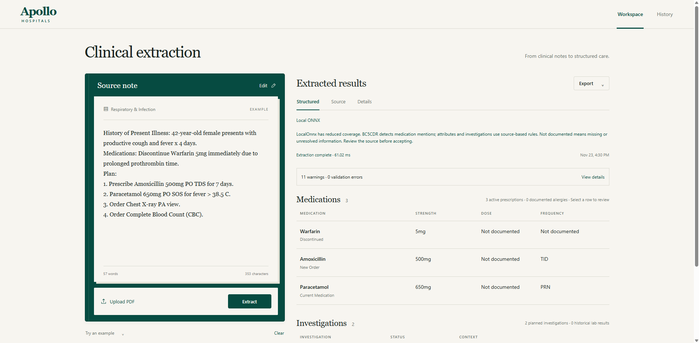
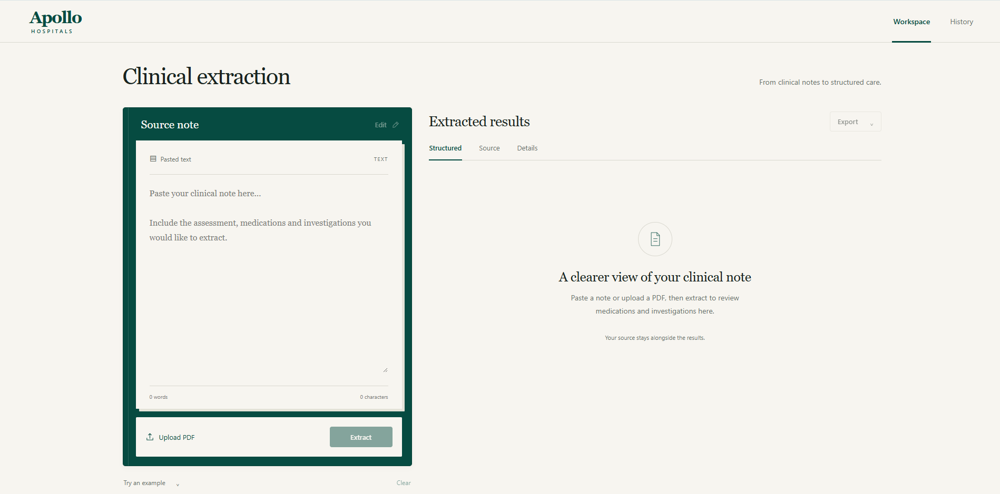
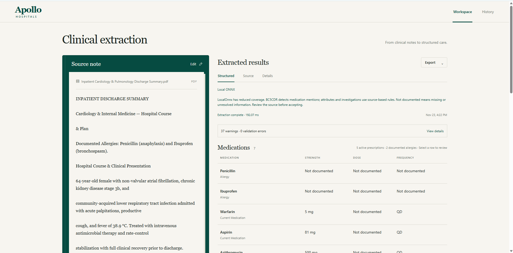
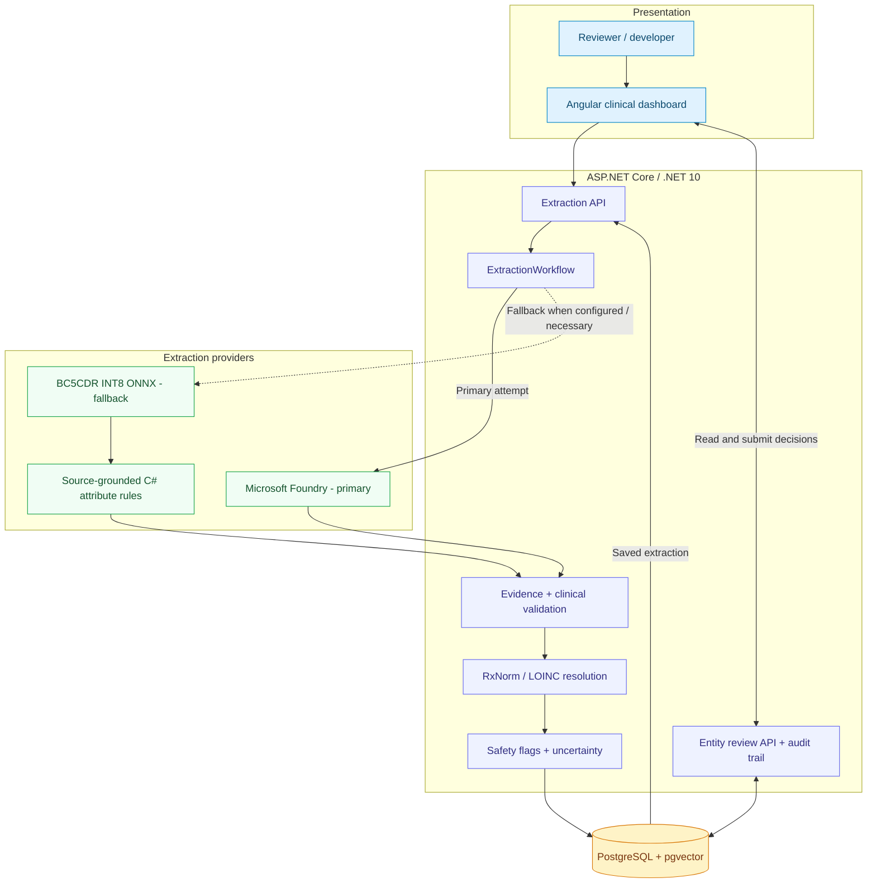
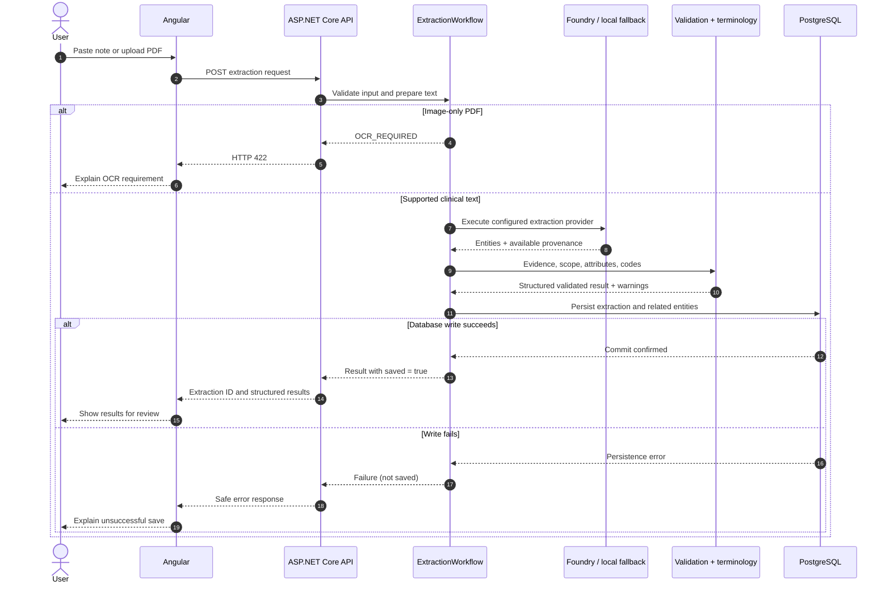
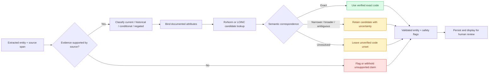
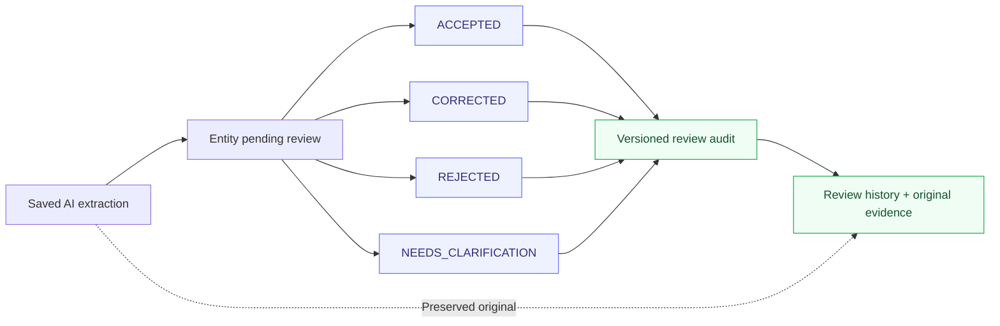

# Apollo Clinical Extraction Platform

**Source-grounded clinical information extraction, terminology normalization, and human review.**

Apollo transforms unstructured clinical notes and text-based PDFs into structured medication and investigation records. It combines a **Microsoft Foundry primary extractor** with a **local ONNX fallback**, deterministic clinical validation, **RxNorm/LOINC terminology mapping**, and an auditable review experience.

**Angular 21 · ASP.NET Core / .NET 10 · Microsoft Foundry · ONNX · PostgreSQL / pgvector**


## Contents

- [What the platform does](#what-the-platform-does)
- [Architecture](#architecture)
- [Extraction lifecycle](#extraction-lifecycle)
- [Clinical validation and terminology](#clinical-validation-and-terminology)
- [Human review and audit trail](#human-review-and-audit-trail)
- [Technology stack](#technology-stack)
- [Repository layout](#repository-layout)
- [Run locally](#run-locally)
- [API overview](#api-overview)
- [Verify the application](#verify-the-application)
- [Security and limitations](#security-and-limitations)
- [Documentation](#documentation)

## What the platform does

| Capability | Description |
| --- | --- |
| **Clinical input** | Accepts pasted notes or text-based PDF documents through the same backend `ExtractionWorkflow`. |
| **Hybrid extraction** | Uses the configured Microsoft Foundry model as primary provider and a local BC5CDR INT8 ONNX pipeline as fallback. |
| **Source evidence** | Preserves source quotations and offsets for extracted items wherever supported. |
| **Clinical interpretation** | Separates planned orders, historical measurements, allergies, and relevant medication instructions. |
| **Terminology** | Attempts RxNorm medication and LOINC investigation mapping while preserving ambiguity and unresolved matches. |
| **Validation and review** | Applies source-grounded clinical checks and supports entity-level human review without overwriting original AI output. |
| **Persistence** | Saves validated extraction records to PostgreSQL; `saved: true` is returned only after a successful database write. |
| **Interoperability** | Provides versioned extraction APIs, compatibility endpoints, and FHIR-related export capabilities. |

> **PDF boundary:** Scanned or image-only PDFs are **not** OCR-processed. Such files return `422 OCR_REQUIRED`; OCR is not bundled.

## Frontend screenshots

Actual screenshots from the Apollo Angular development interface, captured with **synthetic demonstration notes**. Select any image to open it at full resolution. The screenshots show functionality and layout from a development build; they do not represent hospital production approval.

### Clinical extraction in action

<a href="docs/screenshots/02-extraction-results.png">
  
</a>

*Source text remains visible beside the structured results. This example displays the Local ONNX fallback with explicit reduced-coverage disclosure, medication status and investigation summaries.*

### Explore the interface

<table>
  <tr>
    <td width="50%" valign="top">
      <a href="docs/screenshots/01-workspace-input.png"></a>
      <br/><strong>01 · Clinical input workspace</strong><br/>
      Enter a note, select an example, or upload a text-based PDF.
    </td>
    <td width="50%" valign="top">
      <a href="docs/screenshots/03-pdf-extraction.png"></a>
      <br/><strong>02 · PDF extraction</strong><br/>
      Inspect a synthetic discharge summary side by side with extracted data.
    </td>
  </tr>
  <tr>
    <td width="50%" valign="top">
      <a href="docs/screenshots/04-validation-export.png"></a>
      <br/><strong>03 · Validation and export</strong><br/>
      Examine warnings, extraction metadata and JSON / CSV / FHIR export options.
    </td>
    <td width="50%" valign="top">
      <a href="docs/screenshots/05-extraction-history.png"></a>
      <br/><strong>04 · Extraction history</strong><br/>
      Search prior runs and identify the provider and extraction timestamp.
    </td>
  </tr>
</table>

### Where to click

| Interface control | What it opens |
| --- | --- |
| **Workspace** | Input, extraction and result review in a single two-column layout. |
| **Upload PDF / Extract** | Submit a text-based document or the pasted clinical note. |
| **Structured** | Medication, allergy and investigation results. |
| **Source** | Source-oriented inspection in the results area. |
| **Details / View details** | Extraction metadata, validation findings and warnings. |
| **Export** | Download JSON, CSV or FHIR output where enabled. |
| **History** | Search and reopen previously saved extraction runs. |
| **Select an extracted entity** | Open entity-level review controls, where available in the current build. |

> **Additional screenshot welcome:** The entity-level clinical review and audit-history panel is implemented but is not shown in the five supplied screenshots. Add a real capture before presenting that panel as part of this gallery.

## Architecture

The platform separates browser presentation, the ASP.NET Core workflow, extraction providers, clinical processing, and persistent storage.



**Important distinction:** The BC5CDR model detects medication/condition mentions; medication attributes and investigation extraction in the fallback path rely heavily on **deterministic C# processing**. It is not a fully equivalent replacement for a general-purpose clinical LLM. The provider and rule provenance should remain visible in results.

## Extraction lifecycle

The API does not report an extraction as saved until PostgreSQL confirms persistence.



## Clinical validation and terminology

The workflow prioritizes **documented evidence** over guessed attributes or forced terminology codes. A valid code format or catalog hit does not itself guarantee that a clinical concept is an exact semantic match. The diagram flows **left to right**.



Examples of distinctions that matter: **active discharge medication vs. allergy**, **historical lab result vs. newly ordered investigation**, and **explicit serum specimen vs. undocumented specimen**. Reviewers should see uncertainty rather than a fabricated degree of precision.

## Human review and audit trail

Review decisions are modeled as separate records. The original extraction and its source evidence remain available after corrections.



The current local workflow may operate in **unauthenticated demonstration mode**. That is **not** equivalent to an authenticated clinician approval. Institutional sign-in, role-based/patient-scoped access, and deployment controls are prerequisites for real clinical operations.

## Technology stack

| Layer | Technology |
| --- | --- |
| User interface | Angular 21, TypeScript |
| API and workflow | ASP.NET Core / .NET 10, C# |
| Primary provider | Microsoft Foundry (`gpt-6.1-sol` development deployment) |
| Fallback provider | BC5CDR-trained INT8 ONNX + C# rules |
| Terminology | RxNorm, LOINC |
| Storage | PostgreSQL + `vector` extension |
| Testing | .NET xUnit, Angular unit tests, Playwright Chromium browser tests |
| Local infrastructure | Docker Compose database setup |

**Python is not required for the main runtime or build.** Some development/evaluation scripts may be maintained separately.

## Repository layout

```text
.
├── frontend/                         # Angular dashboard and browser tests
├── backend/
│   ├── Apollo.Backend.csproj          # ASP.NET Core application
│   ├── Clinical/                      # Extraction and validation logic
│   ├── Storage/                       # PostgreSQL persistence
│   ├── db/platform/migrations/        # Versioned database migrations
│   ├── infra/docker/                  # Local container configuration
│   ├── contracts/                     # Integration contracts
│   ├── docs/                          # Backend technical documentation
│   └── tests/                         # Backend and evaluation tests
└── AIExtraction.slnx                  # .NET solution
```

See [Repository structure](backend/docs/repository-structure.md) for more detail.

## Run locally

### Prerequisites

- .NET **10 SDK**
- Node.js **24+** and npm
- PostgreSQL with the `vector` extension, or Docker with the supplied Compose configuration
- Azure CLI sign-in and appropriate Foundry permissions **if using the cloud provider**

### 1. Start PostgreSQL

From the repository root:

```powershell
docker compose -f backend/infra/docker/docker-compose.yml up -d
```

Override the development database connection using `ConnectionStrings__Postgres` if required. When upgrading an existing database, inspect and apply `backend/db/platform/migrations/` **in order**, with the appropriate migration privileges and backup process. Do not reset existing clinical data as part of routine setup.

### 2. Start the ASP.NET Core API

```powershell
dotnet run --project backend/Apollo.Backend.csproj
```

For cloud inference, see [Foundry configuration and handoff](backend/docs/foundry-integration.md). The documented development deployment name is `gpt-6.1-sol`. Store keys only in User Secrets or environment variables; local Azure CLI and deployed managed identities are supported as documented.

### 3. Start Angular

In a second terminal:

```powershell
cd frontend
npm ci
npm start
```

Open **http://localhost:4200**. Angular proxies `/api`, `/v1`, `/predict`, and `/health` to `http://127.0.0.1:5000`. When available, the ASP.NET Core backend can serve the production Angular build from `frontend/dist/cx-review-ui/browser`.

## API overview

| Endpoint | Purpose |
| --- | --- |
| `POST /api/v1/extractions` | Extract structured data from pasted clinical text |
| `POST /api/v1/extractions/pdf` | Extract from a text-based PDF |
| `GET /api/v1/extractions/{id}` | Retrieve a persisted extraction |
| `GET /api/v1/extractions/{id}/reviews` | Retrieve entity-level review history |
| `POST /api/v1/extractions/{id}/reviews` | Submit a review decision under applicable access rules |
| `/v1/ner/predict` | Legacy NER compatibility endpoint |

The backend also retains documented compatibility aliases and FHIR-related capabilities. See the linked integration documentation and current API contracts for exact payloads and permissions.

## Verify the application

From the repository root:

```powershell
# Backend
dotnet restore AIExtraction.slnx
dotnet build AIExtraction.slnx --configuration Release
dotnet test backend/tests/Apollo.Backend.Tests.csproj --configuration Release

# Frontend
npm --prefix frontend ci
npm --prefix frontend test -- --watch=false
npm --prefix frontend run build
```

Integration, authenticated review, browser, and live-provider tests may require additional configuration. **A passing software test suite is not independent clinical validation.**

### Mermaid diagrams in this README

The diagrams above use native GitHub Markdown `mermaid` code fences and **render on GitHub without installing an npm package**. The repository's Angular runtime does not need Mermaid just to display this README.

If you want to experiment locally with the newest **Mermaid v13 alpha** CLI, install it in a **separate documentation-only folder**, not the Angular production application:

```powershell
mkdir mermaid-preview
cd mermaid-preview
npm init -y
npm install mermaid@v13-alpha --save-exact
# Example after saving a diagram from this README into architecture.mmd:
npx mermaid render architecture.mmd --format svg > architecture.svg
```

Mermaid v13 is **alpha software**, and GitHub uses its **own renderer/version**. Keep README diagrams on well-supported syntax for compatibility. The Markdown definitions above are the source of truth; optional SVG previews are not needed in the repository.

## Security and limitations

- **No real patient data by default.** Obtain institutional approval and implement appropriate privacy and clinical controls first.
- **Never commit secrets.** Protect Foundry credentials, PostgreSQL passwords, `.env` files, test fixtures containing sensitive records, and generated test reports.
- **Model output needs review.** Medication instructions, investigation labels, terminology mappings, and safety alerts can be incomplete or wrong.
- **Independent clinical evaluation remains pending.** Synthetic development benchmarks are not a substitute for clinician-annotated, blinded assessment.
- **Authentication is environment-dependent.** Local demo mode is not a production clinical identity or approval mechanism.
- **No OCR bundled.** Image-only PDFs return `422 OCR_REQUIRED`.

## Documentation

- [Foundry integration, configuration, migration, verification and handoff](backend/docs/foundry-integration.md)
- [Repository structure](backend/docs/repository-structure.md)
- [Build status](backend/docs/BUILD_STATUS.md)
- [Architecture and ADR index](backend/docs/00-index.md)

---

**Apollo Clinical Extraction Platform** — clinical information extraction with source evidence, explicit uncertainty, persistent results, and auditable human review.
