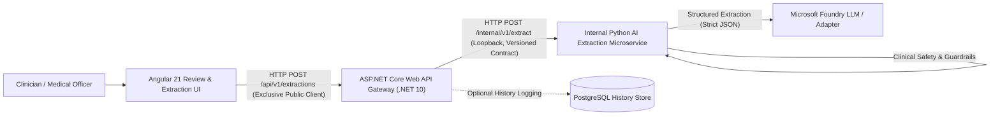
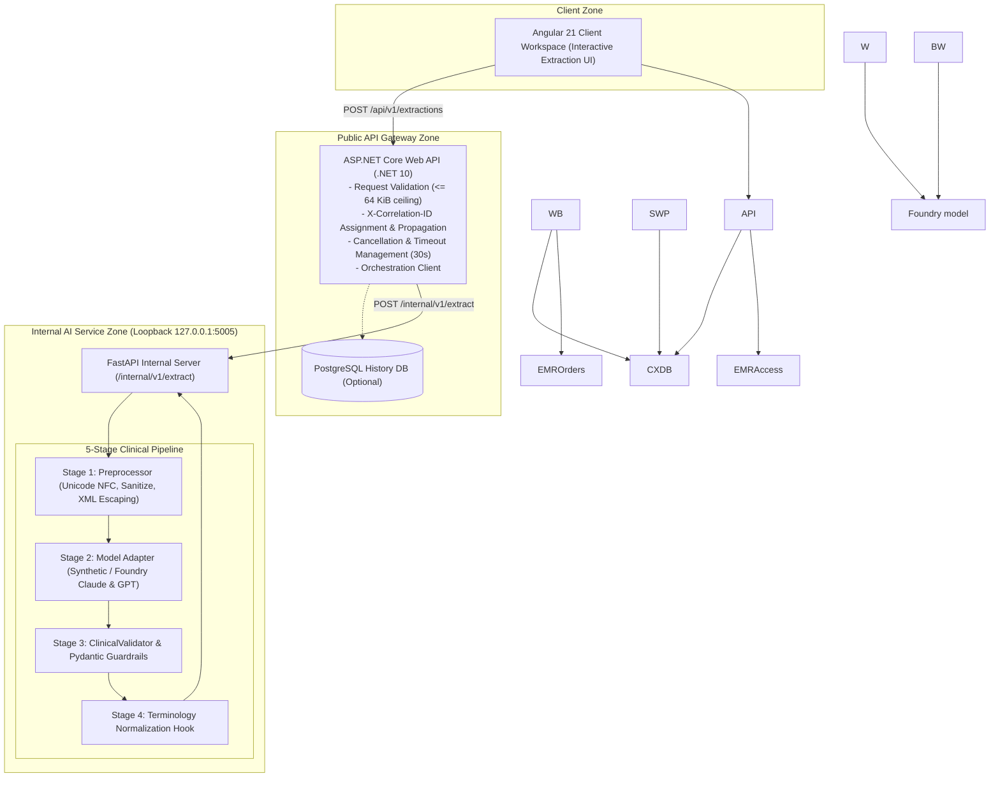
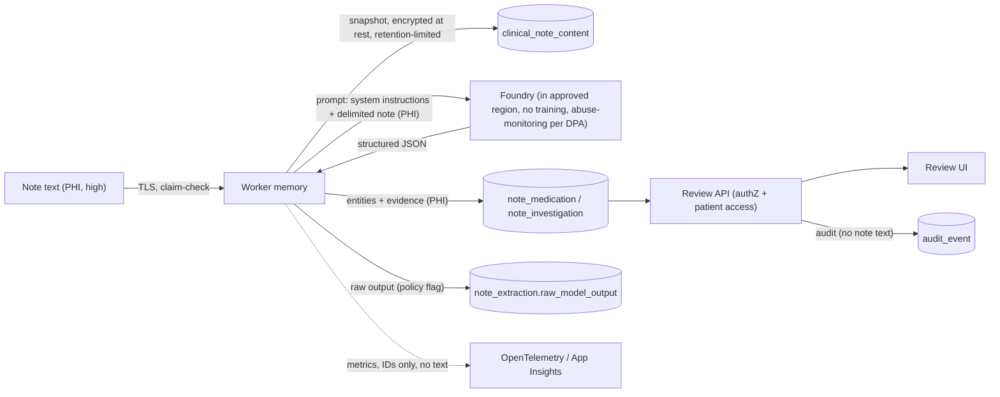
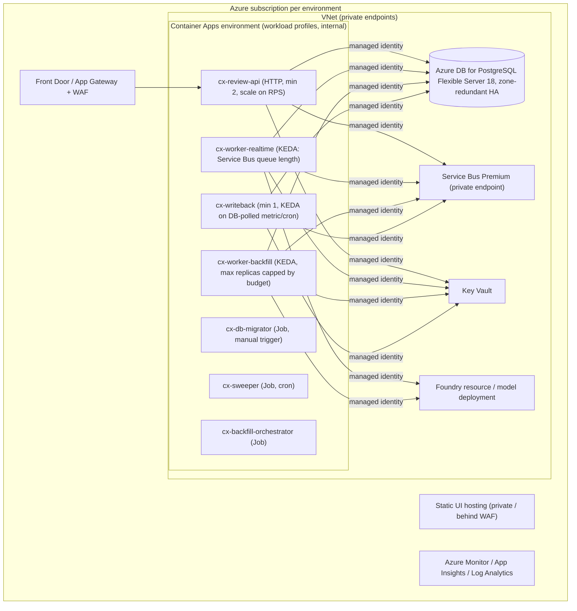
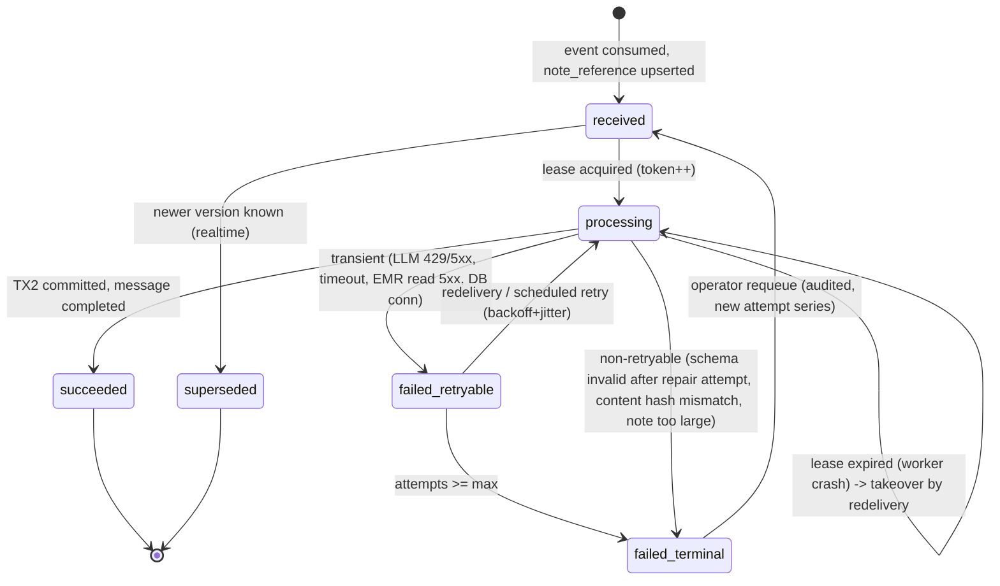

# A. Architecture Specification

Status: REVISED v1.0 (Standalone Clinical Extraction Application). Related: [scope change analysis](scope-change-impact-analysis.md), [ADR-0011](../adr/adr-0011-standalone-architecture-aspnetcore-public-api-python-internal.md), [internal contract](../../contracts/internal/internal-ai-extraction.v1.schema.json).

## 1. System Context & Top-Level Architecture

The platform operates as a standalone clinical information extraction application:



### Architectural Principles & Boundaries
1. **Public API Ownership:** ASP.NET Core Web API (.NET 10) exclusively owns all public-facing REST endpoints. Public clients (including Angular) communicate solely with ASP.NET Core.
2. **Internal AI Isolation:** Python is isolated as an internal-only AI/NLP microservice listening on loopback (`http://127.0.0.1:5005`). It is never directly exposed to the browser or external network.
3. **Explicit Versioned Contract:** Communication between .NET and Python is governed by `contracts/internal/internal-ai-extraction.v1.schema.json`.
4. **Validation Ownership:** Input note validation (size limits, non-empty text, encoding) is performed by ASP.NET Core; LLM output validation (Pydantic schema, verbatim quote offsets, negation consistency, ISMP safety flags) is performed by the Python service.
5. **Direct Synchronous Pipeline:** Interactive extractions execute synchronously without message queue brokers or outbox lag.
6. **Preserved Interoperability Artifacts:** EMR simulation, care-team access control, outbox leasing, and order writeback components are preserved in the repository for future hospital integration reference, but decoupled from the active standalone application runtime.

## 2. Components and Interaction Topology



| Component | Tech | Owns | Scales on |
|---|---|---|---|
| emr-simulator (dev/test only) | ASP.NET Core | Simulated notes, versions, outbox, orders, access policy | n/a |
| Outbox publisher | ASP.NET Core hosted service (in real EMR: EMR team) | Outbox → bus | Outbox lag |
| AI extraction worker | Python 3.13, Pydantic, openai SDK, azure-servicebus | Stages 1–5, extraction tables | Queue length + LLM TPM ceiling |
| Backfill worker | Same image, `CX_TRIGGER=backfill` | Same | Separate quota/budget |
| Backfill orchestrator | Python job | `backfill_job`, checkpoints | Single active instance per job (advisory lock) |
| Review & Ops API | ASP.NET Core 10 | Review, decisions, write-back intent, ops endpoints | HTTP RPS |
| Write-back dispatcher | ASP.NET Core 10 worker | `writeback_operation` state machine | Pending operations |
| Coverage sweeper | Scheduled job (Container Apps Job) | Alerts on stuck notes | Cron |
| Review UI | Angular 22 (or 21 LTS) + Material | — | Static (CDN) |
| DB migrator | .NET console + DbUp + SQL files | Schema | One-shot job |

Domain logic ownership (no duplication): extraction rules live only in Python; review/write-back eligibility rules live only in .NET (`Cx.Domain`); shared enums are generated/tested from `contracts/enums.v1.json`.

## 3. Realtime sequence (happy path + key failure points)

```mermaid
sequenceDiagram
  autonumber
  participant D as Doctor
  participant E as EMR API
  participant EDB as EMR DB
  participant P as Outbox Publisher
  participant SB as Service Bus
  participant W as Worker
  participant R as EMR Read API
  participant F as Foundry
  participant DB as CX PostgreSQL
  participant API as Review API
  participant WB as Write-back
  D->>E: Save/amend note
  E->>EDB: BEGIN; insert note_version; insert extraction_outbox; COMMIT
  E-->>D: 200 Saved (no AI dependency)
  P->>EDB: SELECT ... FOR UPDATE SKIP LOCKED (batch)
  P->>SB: Send(MessageId=event_id)
  P->>EDB: UPDATE published_at
  SB->>W: Deliver (peek-lock)
  W->>DB: TX1 upsert note_reference; claim run (lease, fencing token)
  alt newer version already known
    W->>DB: run=superseded; COMMIT
    W->>SB: Complete
  else
    W->>R: GET note version (verify sha256)
    W->>W: Stage1 preprocess
    W->>F: Stage2 structured extraction
    W->>W: Stage3 validate, verify evidence
    W->>DB: Stage4 terminology lookup (read-only)
    W->>DB: TX2 Stage5 persist (only if fencing token still valid); run=succeeded
    W->>SB: Complete (after commit)
  end
  D->>API: Open review queue / item
  API->>R: (via access policy) check patient/encounter access
  D->>API: Confirm/correct (If-Match)
  API->>DB: TX insert review_decision, update item (row version check), audit
  D->>API: Submit write-back (Idempotency-Key)
  API->>DB: TX insert writeback_operation + items (eligibility re-checked)
  WB->>DB: claim pending item
  WB->>E: POST unsigned order (Idempotency-Key = item key, expected note version)
  WB->>DB: item=succeeded (emr_order_id) / unknown_outcome / failed
```

## 4. Data flow and classification



Classification: **PHI-High** = note text, evidence quotes, raw model output; **PHI-Identifier** = patient/encounter IDs; **Operational** = run status, versions, metrics. Messages carry identifiers + hash only, never note text (ADR-0007).

## 5. Deployment (initial target: Azure Container Apps)



Service Bus **Premium** is assumed for production: private endpoints, predictable throughput, larger messages, geo-DR options (Standard lacks private endpoints). Cost/approval: Q-14.

## 6. Trust boundaries

| TB | Boundary | Controls |
|---|---|---|
| TB-1 | Browser ↔ Review API | Entra ID OIDC (PKCE), JWT validation, RBAC, patient access check, WAF, rate limit, CSP |
| TB-2 | EMR ↔ Service Bus ↔ CX | Managed identity / SAS-free RBAC, private endpoint, event schema validation, no note text in events |
| TB-3 | CX ↔ EMR APIs (read/access/orders) | mTLS or Entra app-to-app tokens (Q-05), idempotency keys, timeouts |
| TB-4 | CX worker ↔ Foundry | Managed identity, private endpoint, **note text treated as untrusted data**, no tools, schema-constrained output |
| TB-5 | Services ↔ PostgreSQL | Per-service DB roles, Entra auth for PG, TLS, column/table grants, audit table insert-only |
| TB-6 | Operators ↔ Ops endpoints | `CX.Operator` role, PIM/JIT elevation, audited |

## 7. Failure and recovery flow



| Failure | Detection | Behaviour | Data-loss guard |
|---|---|---|---|
| Service Bus unavailable | Publisher send fails | Outbox rows stay unpublished; publisher backs off; alert on outbox age | Outbox in EMR DB |
| Publisher crash after send, before mark | — | Re-send; broker duplicate detection (MessageId) + idempotent consumer | Dedup key |
| Worker crash mid-processing | Lock expires | Redelivery; run lease expired → new attempt with higher fencing token; old token writes rejected | Fencing token in TX2 `WHERE lease_token = $me` |
| DB down during TX2 | Exception | Message abandoned (not completed) → retry; LLM call repeated (cost, documented) | Ack after commit |
| Complete() fails after commit | Exception | Redelivery sees `succeeded` → complete, no-op | Idempotent |
| LLM throttled (429) | Status code | Respect `Retry-After`; global token-bucket limiter reduces concurrency; message lock renewed | Lock renewal |
| Poison message (bad schema) | Validation | Dead-letter immediately with reason; run not created or `failed_terminal` | DLQ + alert |
| Out-of-order / stale versions | Version compare | Older version → `superseded`; newer processed | Monotonic `latest_version` |
| Retry exhaustion | MaxDeliveryCount / attempt counter | `failed_terminal` + DLQ + alert; ops requeue | Sweeper |
| Write-back timeout | HTTP timeout | `unknown_outcome` → reconcile by idempotency key → succeeded or safe retry | Item key |
| Region outage | Monitoring | DR runbook (Q-13): restore PG geo-backup, Service Bus geo-DR alias | Backups |

Coverage sweeper (CS-009): periodically finds `clinical_note_reference` rows whose latest run is non-terminal and older than SLA, or (with EMR cooperation, Q-03) outbox events with no corresponding reference, and raises alerts.

## 8. Extraction pipeline internals (worker)

| Stage | Module | Deterministic? | Output |
|---|---|---|---|
| 1 Pre-process | `cx_worker.pipeline.preprocess` | Yes | `PreprocessedNote{text, offset_map, sections[], abbreviation_annotations[]}` |
| 2 LLM extract | `cx_worker.pipeline.extract` via `ExtractionModelAdapter` (Foundry impl; deterministic fixture impl for tests only, refused in non-test envs) | No (temperature 0, seed where supported) | `LlmExtractionOutput` (schema v1) |
| 3 Validate | `cx_worker.pipeline.validate` | Yes | per-item `ValidationFinding[]`, evidence spans |
| 4 Normalise | `cx_worker.pipeline.normalize` | Yes (given terminology release) | `TerminologyCandidate[]`, resolution |
| 5 Score & persist | `cx_worker.pipeline.persist` | Yes | DB rows, run outcome |

The orchestrator is a plain function pipeline (no autonomous agents, no tool calling). Prompt templates are versioned files (`prompts/extraction/v{n}.md`) whose SHA-256 is stored with each run.

