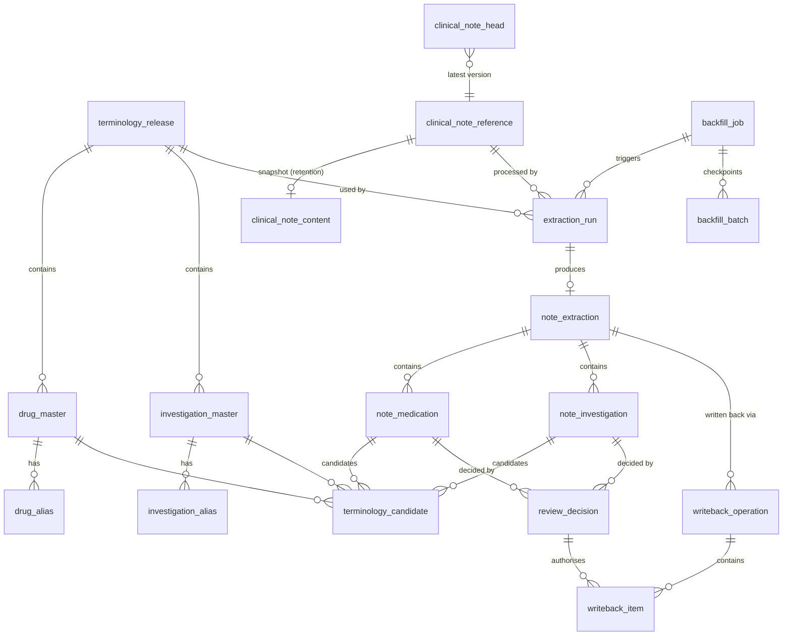

# C. Database Design

Authoritative DDL: [`V0001__baseline_platform.sql`](../../db/platform/migrations/V0001__baseline_platform.sql) (platform) and [`V0001__baseline_emr_simulator.sql`](../../db/emr-simulator/migrations/V0001__baseline_emr_simulator.sql) (simulator). This document explains *why*; column-level truth is the SQL.

> [!IMPORTANT]
> Status: designed, **not yet executed** — no PostgreSQL instance is available on the dev machine (see versions.md). First execution and constraint tests happen in Milestone 1/2.

## 1. Principles

1. The EMR is the system of record. CX stores **references** to immutable note versions plus a retention-limited text snapshot of versions it processed.
2. Identity chain: `patient_id → encounter_id → note_id → note_version → extraction_run → note_extraction → note_medication / note_investigation → review_decision → writeback_item`. An extraction is never identified by patient ID alone.
3. Two databases, two owners: `emr_sim` (simulator; in production = hospital EMR DB) and `cx` (platform).
4. Extracted values are immutable; clinician corrections are append-only `review_decision` rows; write-back payloads are immutable snapshots. This preserves model-vs-clinician deltas for evaluation.
5. Interactive queries are index-backed and bounded; analytics/evaluation run on a read replica or exports (not the primary) once volumes justify it.

## 2. Entity relationship diagram

`audit.audit_event` deliberately has no FKs (append-only, partitioned, must survive retention of referenced rows).

## 3. Table catalogue

| Table | PK | Key FKs | Unique constraints | Main indexes | Owner (writer) | Update semantics | Retention (proposed, Q-10) |
|---|---|---|---|---|---|---|---|
| `terminology.terminology_release` | uuid v7 | — | `release_label`; single `active` (partial unique) | — | Terminology loader | status transitions only | Keep while referenced |
| `terminology.drug_master` / `investigation_master` | uuid v7 | release | (release, hospital code) | GIN tsvector, GIN trigram | Loader | Immutable per release | Keep while referenced |
| `*_alias` | uuid v7 | master | (master, alias_normalized) | btree alias_normalized | Loader | Immutable | As master |
| `cx.clinical_note_reference` | uuid v7 | — | (source_system, note_id, note_version) | (encounter…), (patient, committed_at) | Worker | Immutable | 8 years *(proposed)* |
| `cx.clinical_note_head` | (source_system, note_id) | reference | PK | — | Worker | Monotonic upsert (`WHERE latest_version < new`) | As reference |
| `cx.clinical_note_content` | note_reference_id | reference | PK | purge_after | Worker | Immutable; purged by job | 90 days *(proposed)* — evidence UI then shows 410 |
| `cx.extraction_run` | uuid v7 | reference, release, backfill_job | `dedup_key` | partial (active status), partial (failed), note | Worker; API (requeue cols) | State machine; lease + fencing token | 8 years |
| `cx.note_extraction` | uuid v7 | run (unique), reference | run; one **active** per note version (partial unique) | partial review-queue covering index, encounter | Worker; API (review cols) | review_state, counts, `row_version` | 8 years |
| `cx.note_medication` / `note_investigation` | uuid v7 | extraction, master | (extraction, item_index) | master (partial) | Worker insert; API review cols | Extracted cols immutable; review cols versioned | 8 years |
| `cx.terminology_candidate` | uuid v7 | item, master | — | (item, rank) partial | Worker | Immutable | 2 years *(proposed)* |
| `cx.review_decision` | uuid v7 | extraction, item, master | — | item+time, reviewer+time | API | **Append-only** (no UPDATE/DELETE grant) | Per medico-legal policy (Q-10) |
| `cx.writeback_operation` | uuid v7 | extraction, reference | (requested_by, client key) | extraction | API insert; dispatcher status | State machine, `row_version` | 8 years |
| `cx.writeback_item` | uuid v7 | operation, decision, item | `emr_idempotency_key`; one **live** per item (partial unique) | due (partial), encounter+code (partial) | API insert; dispatcher | State machine, lease + fencing | 8 years |
| `cx.backfill_job` / `backfill_batch` | uuid / (job, batch) | — | `job_name` | — | Orchestrator; API | Cursor checkpoint per batch | 2 years |
| `extraction_outbox` (EMR DB) | bigint identity | — | `event_id` | partial unpublished | EMR | `published_at` once | 7 days after publish |
| `audit.audit_event` | (id, occurred_at) | none | PK | patient+time, actor+time, resource+time | All services (INSERT only) | **Immutable** | ≥ 8 years *(proposed)*; old partitions detached → archive |

Timestamp convention: `timestamptz`, UTC, `_at` suffix, `created_at`/`updated_at` set by writer. Enumerations: `text` + CHECK (ADR-0005), mirrored from `contracts/enums.v1.json`.

## 4. Key invariants enforced by the database

| Invariant | Mechanism |
|---|---|
| One automatic extraction per note version + profile (duplicate events) | `UNIQUE (dedup_key)` on `extraction_run` |
| One active extraction per note version | Partial unique `uq_note_extraction_active` |
| Evidence verified ⇒ offsets present | `ck_*_verified` |
| `matched` ⇔ master FK present | `ck_*_match` |
| Auto-selected candidate must be attribute-compatible | `ck_candidate_auto_compatible` |
| Correct ⇒ values; reject ⇒ reason; alternative ⇒ one master of right type | `ck_review_*` |
| At most one live write-back per extracted item | Partial unique `uq_writeback_item_*_live` |
| Same EMR idempotency key across retries | `UNIQUE emr_idempotency_key`, generated once at insert |
| Client write-back idempotency | `UNIQUE (requested_by, client_idempotency_key)` + `request_fingerprint` comparison |
| Single active terminology release | Partial unique index on status |

## 5. Concurrency strategy

| Scenario | Strategy |
|---|---|
| Two workers receive duplicate events | `INSERT ... ON CONFLICT (dedup_key) DO NOTHING`, then claim with `UPDATE ... SET lease_token = lease_token + 1, lease_owner = $me, lease_expires_at = now()+ttl WHERE id=$id AND (status IN ('received','failed_retryable') OR (status='processing' AND lease_expires_at < now())) RETURNING lease_token`. Zero rows → another live owner → abandon message with delay. |
| Crashed worker's late write | TX2 updates `extraction_run ... WHERE lease_token = $myToken AND status='processing'`; 0 rows → rollback (fencing). |
| Out-of-order versions | `clinical_note_head` upsert only increases `latest_version`; worker compares before calling LLM and again in TX2 (supersede older active extraction in same TX). |
| Two clinicians edit same item | `If-Match` → `UPDATE ... WHERE id=$id AND row_version=$expected`; 0 rows → 412. |
| Decision vs. note amendment race | Decision TX reads `clinical_note_head` `FOR SHARE`; worker supersession TX takes `FOR UPDATE` on same head row → serialised; stale decision → 409. |
| Write-back dispatch | `SELECT ... FOR UPDATE SKIP LOCKED LIMIT n` on due items + lease/fencing token; EMR call outside TX. |
| Outbox publisher (EMR) | `FOR UPDATE SKIP LOCKED` batches; multiple publishers safe; ordering not guaranteed (handled by versions). |

Isolation level: READ COMMITTED + explicit row locks/conditional updates (no reliance on SERIALIZABLE retries on hot paths).

## 6. Query patterns & index justification (to be verified with EXPLAIN ANALYZE on seeded data, M6/M9)

| Query | Index | Expected plan |
|---|---|---|
| Review queue by facility, oldest first, keyset | `ix_note_extraction_review_queue` (partial, covering) | Index scan, LIMIT ≤ 100, no sort |
| Extraction detail (items + candidates + latest decision) | PKs, `uq_note_*_index`, `ix_candidate_*` | 3–4 indexed queries, no N+1 (batch `= ANY($ids)`) |
| Encounter extractions | `ix_note_extraction_encounter` | Index scan |
| Stale check | `clinical_note_head` PK | Single-row lookup |
| Worker dedup/claim | `uq_extraction_run_dedup`, PK | Single-row |
| Due write-back items | `ix_writeback_item_due` (partial) | Small partial index scan |
| Ops failed runs | `ix_extraction_run_failed` (partial) | Index scan |
| Alias lookup | `ix_*_alias_lookup` | Equality |
| Keyword/fuzzy term search | GIN tsvector / trigram | Bitmap index scan, LIMIT |
| Patient audit trail | `ix_audit_patient` per partition | Partition-pruned index scan |

Write amplification review: entity tables carry 2–3 indexes each (PK, unique item index, partial master FK). Partial indexes keep hot state indexes small. Candidate table is the largest by row count (≈ 3–5 × entities) with one index; retention-shortened.

## 7. Partitioning justification

| Table | Decision | Reason |
|---|---|---|
| `audit.audit_event` | **Monthly RANGE partitions now** | Append-only, highest row rate (≈ 8–12 events/note), retention is time-based → drop/detach partitions instead of DELETE (no bloat, no long vacuum). |
| Entity / run tables | **Not partitioned initially** | Modelled ≈ 50–80 M entity rows/year (capacity model) — well within single-table btree performance with the planned indexes. Partitioning would complicate FKs and unique constraints (must include partition key). UUIDv7 keys keep inserts append-local. Re-evaluate when any table exceeds ~500 M rows or retention requires bulk purges (trigger documented in capacity model). |
| `clinical_note_content` | Not partitioned; purge by `purge_after` index in small batches | Volume modest; could move to monthly partitions if purge cost observed. |
| Backfill | Separate queue/worker pool, not separate tables | Same data model; isolation is at compute/queue level. |

## 8. Migration strategy

- Plain versioned SQL (`V####__description.sql`) applied by `Cx.DbMigrator` (DbUp) — journal table `public.schemaversions`. Forward-only; every migration reviewed; destructive changes use expand → migrate → contract across releases.
- Migrator runs as a one-shot job with the owner role; application roles never hold DDL rights.
- CI: apply all migrations to an empty PostgreSQL 18 (Testcontainers) and run schema tests (constraints, grants, enum parity with `enums.v1.json`).
- Irreversible production migrations require explicit approval (working rule §17).
- Partition maintenance: `audit.ensure_partitions()` called by migrator and nightly sweeper job.

## 9. Security in the database

- Group roles per service (`cx_worker_role`, `cx_api_role`, `cx_writeback_role`, `cx_readonly_role`); login identities are Entra managed identities mapped by infra.
- Column-level UPDATE grants restrict each service to the columns it owns.
- No role has UPDATE/DELETE on `audit_event` or `review_decision`.
- `cx_readonly_role` cannot read note text (`clinical_note_content`) or raw model output columns (to be refined with column-level SELECT in M8).
- TLS required (`sslmode=verify-full` in deployed envs); encryption at rest by platform (CMK option Q-12).

## 10. Retention & deletion

A scheduled retention job (M8) purges in bounded batches: `clinical_note_content` after `purge_after`; candidates after 2 years; detaches audit partitions older than policy to archive storage. Patient-level erasure requests (if legally applicable, Q-10) require a documented procedure because medico-legal retention may override. All purges are audited.

## 11. Connection management

- Npgsql pooling per API replica (`Maximum Pool Size` configured); Python `psycopg_pool` per worker replica.
- Budget: `Σ(replicas × pool size) ≤ 80 % of max_connections`; PgBouncer (built into Azure Flexible Server) in transaction mode when replica counts grow — prepared statement compatibility to be verified in M9.

