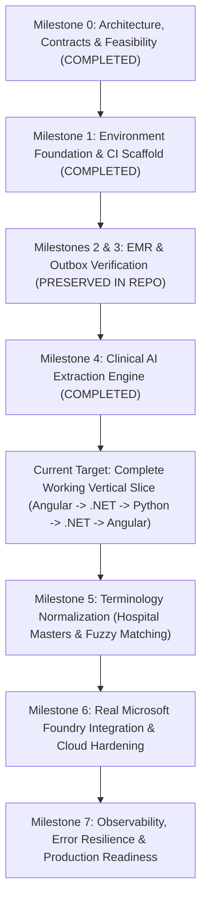

# I. Milestone Implementation Plan & Verification Strategy

Status: **REVISED v1.0 (Standalone Clinical Extraction Application)**  
Guiding Principle: Architecture-first, sequential implementation, empirical verification at every milestone.

---

## 1. Milestone Roadmap (Standalone Application)

---

## 2. Milestone Deliverables and Acceptance Criteria

### Milestone 0: Architecture, Schemas, & Feasibility (Completed)
- **Scope**: Requirements specification, system architecture, database DDL, OpenAPI contracts, event schemas, ADRs, threat model, capacity model, risk register, and RTM.
- **Verification**: Contract consistency checks, zero floating schemas.

### Milestone 1: Environment Foundation & CI Scaffold (Completed)
- **Scope**: Repository structure, .NET 10 Web API solution, Python 3.13 worker project with `uv.lock`, Angular project initialization, local development environment setup, baseline health check endpoints (`/health/live`, `/health/ready`), and linting/formatting pipelines.
- **Verification**: Clean builds across all three stacks (`dotnet build`, `uv run pytest`, `npm run build`), health check returns 200, zero unresolved type or lint errors.

### Milestones 2 & 3: EMR Simulation, Transactional Outbox & Reliability Audit (Preserved in Repo)
- **Scope**: Synthetic patient/encounter simulation, transactional outbox publishing with `FOR UPDATE SKIP LOCKED`, crash recovery, atomic leasing, fault injection tests, and Care Team security check.
- **Verification**: 24 .NET tests passing against live PostgreSQL 18; preserved for enterprise hospital interoperability reference.

### Milestone 4: Clinical AI Extraction Engine (Completed)
- **Scope**: 5-stage clinical extraction pipeline in Python (`cx_worker.pipeline`): Preprocessing & XML wrapping, `SyntheticModelAdapter` harness, `ClinicalValidator` with verbatim offset verification, `MockTerminologyNormalizer`, and `ExtractionPersister`.
- **Verification**: 25 Python tests passing, including all 17 mandatory clinical test cases; 0 mypy errors; 0 ruff errors.

### Current Immediate Target: Complete Working Vertical Slice
- **Scope**:
  1. **Internal Python AI Service**: Lightweight FastAPI microservice on loopback (`http://127.0.0.1:5005/internal/v1/extract`) exposing the 5-stage pipeline conforming to `contracts/internal/internal-ai-extraction.v1.schema.json`.
  2. **ASP.NET Core Public API Gateway**: Public endpoint `POST /api/v1/extractions`, input validation (non-empty, $\le 64\text{ KiB}$ limit), correlation ID assignment, 30s cancellation token, and structured error mapping.
  3. **Angular 21 Client**: Interactive extraction workspace with synthetic note selector, real-time extraction trigger, and rich clinical entity cards.
  4. **End-to-End Verification**: Automated tests covering the complete request flow: Angular $\rightarrow$ .NET $\rightarrow$ Python $\rightarrow$ Mock Model Adapter $\rightarrow$ .NET $\rightarrow$ Angular.

### Milestone 5: Terminology Normalization
- **Scope**: Versioned local medication and investigation master catalogs, multi-tier matching (exact code -> alias -> trigram / token sort -> clinical attribute filtering), candidate ranking and ambiguity scoring.
- **Verification**: Normalization test suite verifying formulation consistency and ambiguity flagging.

### Milestone 6: Real Microsoft Foundry Integration
- **Scope**: Production Foundry adapter via Azure OpenAI SDK / Anthropic on Foundry, system prompts, structured JSON output enforcement, endpoint timeout/circuit breaker resilience.
- **Verification**: Comparative evaluation on synthetic clinical test set against baseline benchmark.

