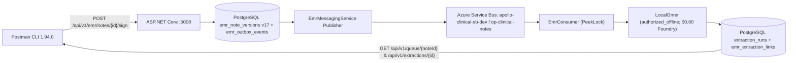

# Apollo Clinical Extraction Platform — Backend-Only End-to-End Verification (Stage G)

**Date:** 25 November 2026  
**Angular Dev Server (`localhost:4200`):** **STOPPED** (`ANGULAR_4200_UP=False`)  
**Hosting Process:** Single `Apollo.Backend` process hosting API, transactional outbox publisher (`EmrMessagingService`), and Azure Service Bus processor (`EmrConsumer`) — zero duplicate workers.

---

## 1. End-to-End Correlation Trace (PostgreSQL + Azure Service Bus)

### Observed Runtime Trace (`backend/logs/PostmanBackend.stdout.log` & `cx_platform`)

1. **API Acceptance & Atomic DB Commit:** Note `7b83e7bc-c817-4284-9306-8318b107adbb` (`P100234 / ENC-100567`) signed as immutable `v17`, creating outbox event `979c29fb-e312-41fc-8634-6c5eeb8c0b1d` (`correlation_id: 3cd2e242-d0ae-4be1-b06f-1e970b3c7781`).
2. **Azure Service Bus Publication:**
   `Publishing EMR outbox event 979c29fb-e312-41fc-8634-6c5eeb8c0b1d for note 7b83e7bc-c817-4284-9306-8318b107adbb v17 (attempt 1)` → `Successfully published EMR event ... to broker` (`publication_status = Published`).
3. **Worker Receipt & Settlement:**
   `Received clinical event 979c29fb-e312-41fc-8634-6c5eeb8c0b1d for note 7b83e7bc-c817-4284-9306-8318b107adbb v17; processing...` → `Clinical event ... outcome: Completed`.
4. **Durable Persistence & REST Retrieval:**
   - `extraction_id = 979c29fb-e312-41fc-8634-6c5eeb8c0b1d`, `adapter_type = onnx_neurosymbolic_int8`, `warning_count = 19`.
   - Retrieved via `GET /api/v1/queue/7b83e7bc-c817-4284-9306-8318b107adbb?version=17&patient=P100234`, `GET /api/v1/extractions/979c29fb-e312-41fc-8634-6c5eeb8c0b1d`, and `GET /api/v1/extractions/979c29fb-e312-41fc-8634-6c5eeb8c0b1d/fhir`.
5. **Swagger UI Verified Independently:** `GET http://127.0.0.1:5000/swagger` → `HTTP 200` (`772 B` HTML pointing to `/openapi/v1.json`).
6. **PostgreSQL Historical Data Preserved:** `60` extraction runs, `140` medications, `175` investigations, `12` review audit rows (zero drops, zero truncations).

---

## 2. Foundry Cost-Control Statement

- Default Development config retains `MicrosoftFoundry` (`gpt-6.1-sol`) as configured primary and `LocalOnnx` as fallback.
- Headless Postman CLI verification ran with `Extraction__Provider=LocalOnnx` (`authorized_offline`) — **0 billable Foundry API calls** executed.
- Offline Foundry contract & fallback routing logic remain verified by `FoundryWorkflowTests` and `Stage8RoutingTests` (`77/77` backend tests passing).
