# Apollo Clinical Extraction Platform — Stage 12.1 Polling & Cross-Patient Data Isolation

**Date:** 25 November 2026  
**Scope:** End-to-end Azure Service Bus asynchronous architecture, PostgreSQL durable worklist projection, RxJS `switchMap` request cancellation, and monotonic request-token identity validation.

---

## 1. Headless API-First Asynchronous Architecture

Angular never connects to or polls Azure Service Bus directly. Azure Service Bus messages are received and settled exclusively by the `.NET` worker (`EmrConsumer`), while PostgreSQL holds the durable clinical worklist and extraction history.

```mermaid
flowchart LR
    EXT["Postman / Swagger / Test UI"] -->|"Authenticated HTTP POST"| API["ASP.NET Core .NET 10 API"]
    API --> PG1[("PostgreSQL: emr_note_versions + emr_outbox_events")]
    PG1 --> PUB["EmrMessagingService"]
    PUB --> SB["Azure Service Bus (op-clinical-notes)"]
    SB -->|"PeekLock"| WORKER[".NET EmrConsumer"]
    WORKER --> INF["Foundry GPT / Eligible LocalOnnx + Clinical Validation"]
    INF --> PG2[("PostgreSQL: extraction_runs + emr_extraction_links")]
    PG2 --> PROJ["GET /api/v1/queue & /api/v1/queue/{noteId}"]
    PROJ -->|"4s RxJS exhaustMap Poll"| UI["Temporary Angular Monitoring Console"]
```

---

## 2. Root Causes of Stale / Cross-Patient UI Leakage Fixed in Stage 12.1

1. **Unrelated Patient Chips Removed from Detail View:** Previously, `.quick-switch-strip` rendered chips for other patients (`P100234`, `P100237`, `P100235`, `P100236`) inside the selected patient's detail header. Stage 12.1 removed `.quick-switch-strip` completely and replaced it with a conditional within-patient `Note version` dropdown containing ONLY notes/versions for the selected `patientId`.
2. **In-Flight Request Cancellation (`switchMap`):** Previously, `openEntry()` called `this.api.getQueueEntry(...).subscribe(...)` imperatively without cancelling prior subscriptions or clearing `selectedEntry` synchronously. Stage 12.1 routes all selections through `selectionTrigger$.pipe(switchMap(...))`:
   - Synchronously clears `selectedEntry`, `highlightedEntity`, `detailError`, and `exportMenuOpen` the instant a new patient or version is selected.
   - Increments monotonic `requestToken` and unsubscribes/cancels any previous patient's in-flight HTTP call automatically via RxJS `switchMap`.
3. **Strict Response Identity Guard (`matchesSelectionIdentity`):** Before committing ANY detail or background-refresh response to `selectedEntry`, [`clinical-queue.ts`](../frontend/src/app/queue/clinical-queue.ts) verifies:
   - `current.token === target.token && target.token === this.requestToken`
   - `detail.noteId === target.noteId`
   - `detail.patientReference.toLowerCase() === target.patientReference.toLowerCase()`
   - `target.version == null || detail.noteVersion === target.version`
   - `detail.extraction == null || detail.extractionId == null || detail.extraction.extractionId === detail.extractionId`
   Any stale or mismatched response is discarded immediately.

---

## 3. Live Polling Behavior

- **Cadence:** `merge(interval(4000), manualRefresh$).pipe(startWith(0), exhaustMap(...), takeUntilDestroyed(destroyRef))` — immediate first fetch, 4-second non-overlapping polling, clean teardown on destroy.
- **Visibility-Aware:** Pauses polling while `document.hidden === true` and triggers an immediate refresh when the browser tab returns to foreground.
- **Headless Detection Proven Live:** Submitting a synthetic note for `P100235` (`STAGE12-1-HEADLESS-638018`) directly via HTTP API without clicking any Angular button or refreshing the page caused Angular's live poller to surface the new entry and update its detail view from in-progress to completed (`Azithromycin` + `Warfarin Discontinued` + `Chest X-ray PA view`) automatically.
