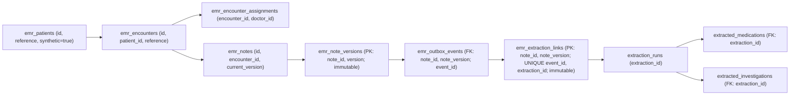

# Apollo Clinical Extraction Platform — Stage 12.1 UHID-Scoped Queue Fix

**Date:** 25 November 2026  
**Scope:** Relational identity verification (`emr_patients` → `emr_encounters` → `emr_notes` → `emr_note_versions` → `emr_outbox_events` → `emr_extraction_links` → `extraction_runs`), backend patient/version scoping contracts, and elimination of cross-patient data leakage.

---

## 1. Database Identity Findings (`cx_platform`)

Inspection of PostgreSQL table definitions in [`V0009__doctor_emr.sql`](../backend/db/platform/migrations/V0009__doctor_emr.sql) and live `cx_platform` rows established that:
- `emr_patients` stores `(id uuid PRIMARY KEY, reference text NOT NULL UNIQUE, synthetic boolean NOT NULL CHECK (synthetic = true))`.
- Identifiers `P100234`, `P100235`, `P100236`, and `P100237` are **synthetic patient references** (`synthetic = true`), used as demonstration UHIDs in development rather than production hospital UHIDs.
- The temporary Angular viewer labels the table column `UHID / Patient ID` and the selected detail header `Patient ID (Synthetic)` to maintain strict clinical truthfulness without misrepresenting synthetic IDs as production UHIDs.

---

## 2. Verified Relational Identity Chain

Every patient record, clinical note version, and extraction run is bound by PostgreSQL foreign keys and immutability triggers (`emr_reject_immutable_change()`):

### Live `cx_platform` Linkage Evidence (Captured 25 Nov 2026)

| Synthetic Patient Ref | Encounter Ref | Note ID | Version | Event ID | Extraction ID | Adapter | Backend Warnings | Meds | Invs |
| --- | --- | --- | --- | --- | --- | --- | --- | --- | --- |
| `P100234` | `ENC-100567` | `7b83e7bc-c817-4284-9306-8318b107adbb` | `11` | `05bae210-308b-487c-98bc-1a13c3cf5a9d` | `05bae210-308b-487c-98bc-1a13c3cf5a9d` | `onnx_neurosymbolic_int8` | `7` | `2` | `2` |
| `P100235` | `ENC-100568` | `748adbb3-578b-471c-abac-5846019ae167` | `10` | `c2f94fdc-50d0-4718-8416-ad3abf8bcd54` | `c2f94fdc-50d0-4718-8416-ad3abf8bcd54` | `onnx_neurosymbolic_int8` | `7` | `2` | `2` |
| `P100236` | `ENC-100569` | `ed03e10d-ad17-493f-b818-8c93154a6e05` | `1` | `b04788d0-9f9a-44e0-99d1-80ffec377829` | *(in progress)* | — | — | `0` | `0` |
| `P100237` | `ENC-100570` | `a5abf136-8544-4dae-ae79-f4f55d5ad688` | `15` | `a13551a5-bc92-4df7-a201-9a3310d6e5e9` | `a13551a5-bc92-4df7-a201-9a3310d6e5e9` | `onnx_neurosymbolic_int8` | `16` | `4` | `2` |

---

## 3. Backend Contract Enhancements

1. **[`backend/Emr/EmrContracts.cs`](../backend/Emr/EmrContracts.cs):**
   - Added relational identifiers (`PatientId`, `EncounterId`, `EventId`, `PatientNoteCount`) to `QueueItemDto`.
   - Added `PatientNoteOptionDto` for strictly within-patient note/version selection.
   - Added `PatientId`, `EventId`, `ExtractionId`, and `PatientNotes` to `QueueEntryDetailDto`.
2. **[`backend/Emr/EmrStore.cs`](../backend/Emr/EmrStore.cs):**
   - Updated `QueueEntryHeader(doctor, noteId, requestedVersion, expectedPatientReference, ct)` to bind `emr_note_versions`, `emr_outbox_events`, `emr_extraction_links`, and `extraction_runs` strictly on `(note_id, version)` and reject any mismatched `expectedPatientReference` or unauthorized `doctor_id` with `null` (`HTTP 404`).
   - Added `PatientNotesForPatient(doctor, patientId, ct)` returning ONLY signed/current versions belonging to `e.patient_id = @patient` and `a.doctor_id = @doctor`.
   - Added `PatientScope(doctor, patientReference, ct)` backing `GET /api/v1/queue/patients/{patientReference}`.
3. **[`backend/Emr/EmrEndpoints.cs`](../backend/Emr/EmrEndpoints.cs):**
   - Enhanced `GET /api/v1/queue/{noteId:guid}?version={int}&patient={string}` to enforce patient reference and version scoping server-side and return only within-patient `patientNotes`.
   - Added `GET /api/v1/queue/patients/{patientReference}` returning `404 PATIENT_NOT_FOUND` for unauthorized or nonexistent patient references.
   - Preserved all headless ingestion, extraction, FHIR, and health endpoints on port `5000` independently of Angular.
