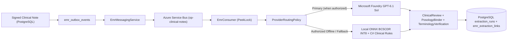

# Apollo Clinical Extraction Platform — Stage 12 Microsoft Foundry & Local ONNX Processing

**Date:** 24 November 2026  
**Scope:** Provider routing policy, cost-control compliance during Stage 12, real Azure Service Bus asynchronous processing, and honest provider provenance rendering.

---

## 1. Processing Pipeline

---

## 2. Zero-Cost Policy Compliance (Stage 12)

- **Live Billable Foundry Calls Executed in Stage 12:** **0** (`$0.00` spent).
- **Configured Primary Provider (Default Development Config):** `backend/appsettings.Development.json` retains `Extraction:Provider = "MicrosoftFoundry"`, `FallbackProvider = "LocalOnnx"`, `Foundry:Deployment = "gpt-6.1-sol"`.
- **Stage 12 Live Local Verification Mode:** During Stage 12 live E2E verification, the backend was launched with explicit environment overrides:
  - `Extraction__Provider=LocalOnnx`
  - `Extraction__AllowDirectLocal=true`
  - `Extraction__DirectLocalReason=authorized_offline`
  - `Emr__Messaging__Mode=AzureServiceBus`
- **Foundry Verification Without Spend:**
  1. Offline automated contract & routing tests (`FoundryWorkflowTests`, `Stage8RoutingTests`, `Stage8ConfigurationTests`) verified Foundry payload parsing, fallback triggers, timeout/circuit handling, and routing invariants.
  2. Screenshot `05-foundry-provenance.png` renders the **real persisted historical Foundry `gpt-6.1-sol-2026-09-29` extraction** (`extraction_id: 6430f85d-41f5-4dc8-86be-aa208dc34b9d`, `1,274 tokens`, `6.43 s`) exported read-only from `cx_platform` without issuing any new cloud API call.

---

## 3. Truthful Provider Provenance Rules

| Provider | UI Provenance Bar | Token / Cost Display | Limited-Coverage Disclosure |
| --- | --- | --- | --- |
| **Microsoft Foundry (`foundry`)** | `Microsoft Foundry · <actual model>` + `Primary cloud extraction` | Actual recorded `totalTokens` and `estimatedCostUsd` (or `Not recorded` if absent) | Not shown |
| **Local ONNX (`onnx`)** | `Local ONNX · <actual model>` + `Authorized local offline mode` or `Fallback active · <classified reason>` | `N/A (Local ONNX)` | **Always shown:** explicit notice explaining BC5CDR + deterministic rule reduced coverage |

No fabricated model names, token counts, costs, or synthetic confidence percentages are rendered anywhere in the Stage 12 workspace.

---

## 4. Real Azure Service Bus Verification

- **Namespace:** `apollo-clinical-sb-dev.servicebus.windows.net`
- **Queue:** `op-clinical-notes`
- **Authentication:** `DefaultAzureCredential` via local Azure CLI (`C:\Users\intern_ali\AppData\Local\ApolloTools\AzureCLI\bin\az.cmd`) — zero connection strings or SAS keys.
- **Verified Flows:**
  1. `Stage9RealServiceBusSmokeTests.RealAzureServiceBus_SendReceiveCompleteAndIdempotency_Succeeds` — **PASS** (22 s).
  2. Live Playwright E2E submitted synthetic note `STAGE12-LIVE-398057` via `POST /api/v1/emr/notes/{id}/corrections` + `POST /api/v1/emr/notes/{id}/sign` → `emr_outbox_events` → `EmrMessagingService` → Azure Service Bus `op-clinical-notes` → `EmrConsumer` → `LocalOnnx` extraction → persisted in `extraction_runs` & `emr_extraction_links` → automatically observed as `Ready` by RxJS live polling in `http://localhost:4200/`.
