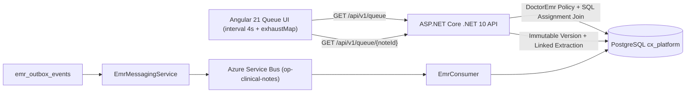

# Apollo Clinical Extraction Platform — Stage 12 Queue Polling API & Security Contract

**Date:** 24 November 2026  
**Scope:** Read-only PostgreSQL queue polling endpoints, RxJS live polling orchestration, and Development-only loopback auto-session security controls.

---

## 1. End-to-End Queue Polling Architecture

**Critical Isolation Rule:** The HTTP polling endpoints (`GET /api/v1/queue` and `GET /api/v1/queue/{noteId}`) are strictly **read-only PostgreSQL projections**. They **never** peek, lock, or consume Azure Service Bus messages.

---

## 2. API Endpoints

### `POST /api/v1/emr/auth/dev-session`
- **Purpose:** Enables direct opening of `http://localhost:4200/` without a visible login wall in authorized local development while preserving server-side authentication and encounter-scoped isolation.
- **Hard Security Gates (`EmrEndpoints.cs`):**
  1. `app.Environment.IsDevelopment()` must be `true`.
  2. `ClinicalApiSecurity.IsDemo(cfg, env)` must be `true`.
  3. `IPAddress.IsLoopback(http.Connection.RemoteIpAddress)` must be `true`.
  4. Rejects with `HTTP 403 DEV_SESSION_DISABLED` whenever any gate fails.
- **Behavior:** Issues a real 30-minute persisted `emr_sessions` row via `DoctorSessions.CreateDevelopmentLoopbackSession(...)`, logs a `DevLoopbackSessionIssued` audit event, sets the `HttpOnly` `Apollo.Doctor` cookie, and rotates the `XSRF-TOKEN` anti-forgery cookie. Zero credentials exist in frontend source code.

### `GET /api/v1/queue`
- **Authorization:** Requires `DoctorEmr` policy (unauthenticated requests receive `HTTP 401 Unauthorized`). Every query joins `emr_encounter_assignments a ON a.encounter_id = e.id WHERE a.doctor_id = @doctor`.
- **Query Parameters:** `search` (optional substring across patient ref, encounter ref, note ID, or text), `state` (`all | waiting | queued | extracting | ready | failed`), `limit` (1–100, default 50), `offset` (default 0).
- **Performance & Privacy:** Single SQL CTE query (zero N+1), returns compact `sourcePreview` truncated to `<= 180` characters (never full note payloads in list polls), ordered newest-first (`ORDER BY received_at DESC, note_id`).
- **Response (`QueueListResponse`):**
  - `items`: array of `QueueItemDto` (`noteId`, `noteVersion`, `patientReference`, `encounterReference`, `encounterDate`, `receivedAt`, `sourcePreview`, `wordCount`, `noteStatus`, `queueState`, `verificationRecommended`, `rawProcessingStatus`, `extractionId`, `provider`, `model`, `fallbackTriggered`, `warningCount`, `errorCount`, `error`)
  - `total`: total matching count
  - `serverTimeUtc`: server UTC timestamp
  - `requestedPrimaryProvider`, `fallbackProvider`: configured routing policy

### `GET /api/v1/queue/{noteId:guid}`
- **Authorization:** `DoctorEmr` policy + strict SQL join `WHERE n.id = @note AND a.doctor_id = @doctor`. Cross-doctor note access returns `HTTP 404 QUEUE_ENTRY_NOT_FOUND`.
- **Response (`QueueEntryDetailDto`):** Returns the complete immutable `sourceText`, SHA-256 `sourceHash`, timestamps, normalized `queueState`, raw processing error (if failed), and the linked `ClinicalExtractionResponse` (or `null` while `Waiting` / `Queued` / `Extracting` / `Failed`).

---

## 3. State Mapping Contract

| Persisted Database State | Normalized `queueState` | `verificationRecommended` | UI Display |
| --- | --- | --- | --- |
| `l.extraction_id IS NOT NULL` & `r.extraction_id IS NOT NULL` | `Ready` | `true` if `Needs Review` or warnings/errors > 0 | `Ready` or `Ready · Verification recommended` |
| `o.processing_status = 'Failed'` or `o.publication_status = 'Failed'` | `Failed` | `false` | `Failed` + explicit diagnostic error |
| `o.processing_status = 'Processing'` | `Extracting` | `false` | `Extracting` (animated indicator) |
| `o.processing_status = 'Queued'` or `o.publication_status = 'Published'` | `Queued` | `false` | `Queued` |
| Newly signed draft / `Pending Publication` | `Waiting` | `false` | `Waiting` |

---

## 4. Frontend RxJS Live Polling Design

Implemented in [`clinical-queue.ts`](../frontend/src/app/queue/clinical-queue.ts):
- **Non-overlapping cadence:** `merge(interval(4000), manualRefresh$).pipe(startWith(0), exhaustMap(...), takeUntilDestroyed(destroyRef))` ensures in-flight responses never race or pile up.
- **Tab-visibility awareness:** Subscribes to `document.visibilitychange`; pauses network polling while the tab is hidden (`Paused (tab inactive)`) and triggers an immediate refresh on tab return.
- **Open-entry auto-synchronization:** Tracks a signature (`noteVersion:queueState:extractionId:receivedAt`) for the currently inspected entry and silently updates `GET /api/v1/queue/{noteId}` when processing transitions to `Ready` without resetting user scroll or clearing selected evidence.
- **Fault tolerance:** Transient network errors display a non-blocking banner (`Reconnecting · Last snapshot retained`) while retaining the last displayed queue list and opened clinical note.
