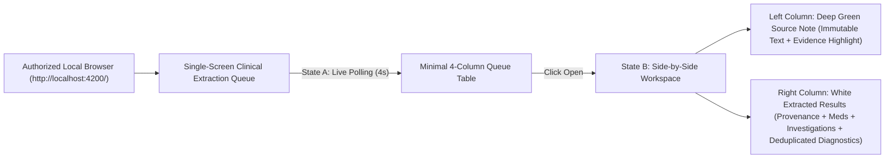

# Apollo Clinical Extraction Platform — Stage 12 Single-Screen Live Queue Redesign

**Date:** 24 November 2026  
**Scope:** Replacement of the multi-page Doctor OP EMR Portal frontend with a single-screen, live polling Clinical Extraction Queue workspace preserving the Apollo Hospitals clinical visual identity and complete backend architecture.

---

## 1. Architectural Shift

Stage 12 simplifies the active frontend entry point (`http://localhost:4200/`) from a multi-page outpatient EMR portal into one calm, high-density, real-time clinical extraction workspace centered on incoming clinical notes.

---

## 2. Elements Explicitly Removed from the Active UI

Every multi-page portal control targeted by Stage 12 has been eliminated from the active application shell (`frontend/src/app/emr/portal-shell.ts`), routing (`frontend/src/app/app.routes.ts`), and primary component (`frontend/src/app/queue/clinical-queue.*`):

| Removed Legacy Element | Verification |
| --- | --- |
| Visible Doctor Login / "Welcome back" screen | Replaced by Development loopback auto-session (`POST /api/v1/emr/auth/dev-session`); `/login` redirects to `/`. Fails closed with explicit auth card outside Development loopback. |
| "Doctor Dashboard" heading & "Outpatient encounters and clinical documentation" subtitle | Replaced by **Clinical Extraction Queue** (`"Clinical notes and AI-extracted information."`). |
| 5 KPI summary cards (`Assigned Encounters`, `Draft Notes`, `Signed Notes`, `Awaiting Extraction`, `Extraction Completed`) | Completely absent from DOM. |
| 5 top horizontal navigation tabs (`OP EMR`, `Clinical Extraction`, `Review & Validation`, `Extraction History`, `Administration`) | Removed from `PortalShell`. |
| Entire left OP EMR sidebar (`Dashboard`, `Patients`, `Encounters`, `Clinical Notes`, `My Tasks`) | Removed from `PortalShell`; `aside` count = 0. |
| Standalone dashboard columns (`Consultation Type`, `Note Status`, `Extraction Status`) | Replaced by 4 minimal columns: `Queue Entry`, `Clinical Note` (with inline status badge), `Received`, `Action`. |
| Doctor Review & Validation / Approval controls (`Accept`, `Reject`, `Correct`, `Submit Review`) | Removed from active UI. Historical `entity_review_audit` rows remain untouched in PostgreSQL. |

---

## 3. Single-Screen Two-State Experience

### State A — Live Polling Queue
- **Header:** Apollo Hospitals lockup + `Clinical Extraction Queue` + live polling badge (`Live · Updated just now` / `Paused (tab inactive)` / `Reconnecting · Last snapshot retained`) + compact `Refresh` + optional collapsible `+ Add Note` intake drawer.
- **Toolbar:** Search input (patient, encounter, or note preview), inline state filter (`All`, `Ready`, `Extracting`, `Waiting`, `Failed`), and live count.
- **Table Columns:** `Queue Entry` (Patient ID, Encounter ID, Note version), `Clinical Note` (1-line preview + inline state pill + compact provider chip + word count), `Received`, `Action` (`Open`).

### State B — Side-by-Side Clinical Inspection
- **Compact Return Bar:** `← Back to queue`, entry metadata breadcrumb, live status pill, and quick-switch pills for switching directly between queued entries.
- **Left Column (`Source note`):** Classic Apollo emerald green (`#064B41`) outer frame with warm ivory (`#F7F5F0`) scrollable read-only document preserving exact line breaks, section headings, word count, SHA-256 fingerprint prefix, and click-to-highlight evidence spans (`<mark>`).
- **Right Column (`Extracted results`):** Clean white surface displaying truthful provider provenance, explicit Local ONNX limited-coverage notice when applicable, separate `Strength` and `Dose` columns for medications, defensible LOINC exact/candidate mapping for investigations, collapsible deduplicated validation diagnostics, and `JSON` / `CSV` / `FHIR R4 Bundle` exports.

---

## 4. Clinical Extraction Defect Fixes (Section 10)

1. **Duplicate Warnings Eliminated (10A):**
   - Backend [`ClinicalReview.cs`](../backend/Clinical/ClinicalReview.cs) deduplicates investigation flags and findings idempotently via a local `Flag(...)` helper.
   - Frontend `deduplicateExtractionWarnings(...)` in [`clinical-queue.ts`](../frontend/src/app/queue/clinical-queue.ts) (and `allFindings` in [`app.ts`](../frontend/src/app/app.ts)) deduplicates `qualityFlags` against structured `findings` codes so badge counts match rendered diagnostic cards 1-to-1 (`BadgeCount=5, RenderedItems=5` verified in live E2E).
2. **Strength vs Administered Dose Separation (10B):**
   - [`PosologyBinder.cs`](../backend/Clinical/PosologyBinder.cs) expands administered dose matching (`half tablet`, `1/2 tablet`, `sachet`, `vial`, `ampoule`, `patch`, `spray`, `tsp`, `tbsp`) while preserving clinical safety when only product strength is documented.
   - Medications table displays `Strength` and `Dose` in distinct columns and renders `"Not documented"` explicitly when administered dose is absent.
3. **Defensible Complete Blood Count LOINC Mapping (10C):**
   - [`TerminologyVerification.cs`](../backend/Clinical/TerminologyVerification.cs) resolves exact LOINC `58410-2` when automated CBC is explicitly stated (`complete blood count automated`, `automated cbc`), while retaining `narrower` semantic status + `candidateCode: "58410-2"` for generic `"Complete Blood Count"`.
   - Frontend renders `Candidate LOINC 58410-2 (narrower — withheld)` plus the full clinical `mappingNote` instead of misleading `"Unresolved"`.
4. **Honest Provider & Limited-Coverage Disclosure (10D–10H):**
   - Local ONNX extractions display `"Local ONNX · bc5cdr_int8"`, `"N/A (Local ONNX)"` tokens, and an explicit limited-coverage notice. No confidence scores, token counts, costs, or GPT labels are ever fabricated.
