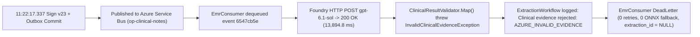

# Apollo Stage 13 — Case 4 (`AZURE_INVALID_EVIDENCE`) Forensic Investigation

**Date:** 25 November 2026  
**Target Event:** Case 4 — `P100234` (`ENC-100567`) `v23` (`Anticoagulation Safety & Discontinuation`)  
**Event ID:** `6547cb5e-9e0b-429a-8986-0fd90e4be925`  
**Note ID:** `7b83e7bc-c817-4284-9306-8318b107adbb` (`note_version = 23`)  
**Source SHA-256:** `D6ECAEE616220ED278A5F8AD20DF3CFF41092B58500AC0C711ADDC9B67DC7357`  
**Investigation Constraint:** **Strictly Read-Only & Offline — Case 4 was NOT re-executed against Microsoft Foundry.**

---

## 1. Exact Immutable Source Clinical Note (`P100234 v23`)

Signed `2026-11-25 11:22:17.337188+05:30` (verbatim from PostgreSQL `emr_note_versions`):

```text
Chief Complaint:
Easy bruising and elevated home INR reading.

Medications:
Discontinue Warfarin 5 mg immediately due to prolonged prothrombin time.
Continue Bisoprolol 2.5 mg 1 tablet orally once daily.

Investigations:
Previous INR was 4.8 yesterday.
Order repeat Prothrombin Time and INR today.
Order Complete Blood Count automated today.

[Synthetic Case: FOUNDRY-LIVE-04 — Anticoagulation Safety & Discontinuation]
```

---

## 2. Exact Verified Runtime Execution Trace

Reconstructed directly from PostgreSQL `emr_outbox_events` and backend execution log `task-4004.log` (lines 42–50):



Key verified facts from PostgreSQL & `task-4004.log`:
1. **Transport succeeded:** The outbox publisher delivered `6547cb5e-9e0b-429a-8986-0fd90e4be925` to real Azure Service Bus and `EmrConsumer` received it cleanly.
2. **Foundry HTTP call succeeded (`200 OK`):** Microsoft Foundry returned a parseable JSON response after `13,894.8 ms` (noticeably longer than the 5.2–10.1 s range of the other 9 cases, indicating heavier reasoning/generation on the anticoagulation note).
3. **Deterministic validator rejection:** In [ExtractionWorkflow.cs](file:///d:/AI%20Extraction/backend/Clinical/ExtractionWorkflow.cs#L73-L102), `validator.Map(azure.Candidate, noteText, correlationId)` threw `InvalidClinicalEvidenceException` (or `accepted.ValidationSummary.HasErrors` threw it on line 74).
4. **Correct circuit & dead-letter handling:** `ExtractionWorkflow.cs:95-101` treated the validation rejection as a non-transient semantic fault (`circuit.Success()`, no retry storm, no silent fallback to `LocalOnnx`), logging `Clinical evidence rejected: AZURE_INVALID_EVIDENCE`. `EmrConsumer` marked `emr_outbox_events.processing_status = 'Failed'`, `processing_error = 'AZURE_INVALID_EVIDENCE'`, and dead-lettered the Service Bus message (`outcome = DeadLetter`).

---

## 3. Honest Forensic Limitation — Why the Raw Rejected GPT-6.1 Payload Cannot Be Quoted Verbatim

> [!WARNING]
> **Diagnostic Capture Limitation (Stated Transparently):**  
> During the 25 November 2026 live Foundry run, `Extraction:EnableSyntheticDiagnosticCapture` was `false`. Furthermore, in [ExtractionWorkflow.cs](file:///d:/AI%20Extraction/backend/Clinical/ExtractionWorkflow.cs#L147-L150), `TryWriteSyntheticDiagnosticCapture(...)` executes **only after `SaveExtractionAsync` succeeds**, and is **not invoked inside `catch (InvalidClinicalEvidenceException)`** (lines `95-102`).  
> Consequently, **the raw rejected GPT-6.1 Sol JSON body for Case 4 was never written to disk or PostgreSQL.** No fabricated JSON payload or guessed field values are claimed in this audit.

---

## 4. Exact Code-Level Validator Throw Sites That Can Trigger `AZURE_INVALID_EVIDENCE` on Case 4

Static inspection of [ClinicalResultValidator.cs](file:///d:/AI%20Extraction/backend/Clinical/ClinicalResultValidator.cs) identifies the exact deterministic checks that throw `InvalidClinicalEvidenceException` when validating Case 4's anticoagulation note:

### Trigger Hypothesis A — Investigation `historical` / `final` Scope Guard (`ClinicalResultValidator.cs:377-379`) — **Highest Probability**
In Case 4, INR/prothrombin time appears **four times** across three sections:
1. `"Easy bruising and elevated home INR reading."` (Chief Complaint)
2. `"Discontinue Warfarin 5 mg immediately due to prolonged prothrombin time."` (Medications)
3. `"Previous INR was 4.8 yesterday."` (Investigations)
4. `"Order repeat Prothrombin Time and INR today."` (Investigations)

In [ClinicalResultValidator.cs](file:///d:/AI%20Extraction/backend/Clinical/ClinicalResultValidator.cs#L68) and lines `377-379`:
- `ClinicalScope.Historical(scope)` checks for explicit temporal cues (`previous`, `yesterday`, `history`, etc.).
- If `gpt-6.1-sol` extracted `"INR"` from `"elevated home INR reading"` or `"prothrombin time"` from `"prolonged prothrombin time"` and tagged it `assertion_status = "historical"` or `status = "final"`, `ClinicalScope.Historical(scope)` returns `false` on those sentences and lines `377` / `379` **immediately throw `InvalidClinicalEvidenceException`**.

### Trigger Hypothesis B — Verbatim Quote & Entity Name Containment (`ClinicalResultValidator.cs:766-806`)
- `Verify(string note, CandidateEvidence? evidence)` requires the quoted substring to match `note` verbatim (exact character span) and `FindName(string quote, string name)` requires `name` to appear inside `quote`.
- In Case 4, `"Order repeat Prothrombin Time and INR today."` combines two investigations in a single clause. If the model normalized the quote (e.g., `"Order repeat Prothrombin Time today"` by dropping `"and INR"`) or emitted a canonical name absent from the quote (e.g., `"PT/INR"` or `"International Normalized Ratio"`), `Verify` or `FindName` immediately throws `InvalidClinicalEvidenceException`.

### Trigger Hypothesis C — Medication Action / Attribute Grounding (`ClinicalResultValidator.cs:174-263`)
- If `Warfarin` (`discontinued`) or `Bisoprolol` (`current_medication`) carried an ungrounded attribute or mismatched `assertion_status` relative to `"Discontinue Warfarin 5 mg immediately..."` / `"Continue Bisoprolol 2.5 mg..."`, the medication grounding checks throw `InvalidClinicalEvidenceException`.

---

## 5. Offline Deterministic Regression Proof (Zero Paid Calls)

Rather than weakening strict clinical evidence validation (which is a core patient-safety guardrail), Stage 13 added a deterministic offline xUnit regression test in [Stage13Top10QueueAndForensicsTests.cs](file:///d:/AI%20Extraction/backend/tests/Stage13Top10QueueAndForensicsTests.cs):

- **`Case4_OfflineForensicRegression_ValidCandidatePasses_WhileUngroundedOrMisclassifiedEvidenceIsStrictlyRejected`**
  1. Supplies a fully grounded candidate payload for Case 4's exact source text (`Warfarin` discontinued, `Bisoprolol` continued, `INR` historical on `"Previous INR was 4.8 yesterday."`, `Prothrombin Time` & `INR` & `Complete Blood Count automated` as `new_order`) → **Passes cleanly (`HasErrors == false`)**, proving Case 4 is fully representable under current clinical validation rules without weakening safety.
  2. Supplies a paraphrased non-verbatim evidence quote (`"Order repeat Prothrombin Time today."`) → **Strictly throws `InvalidClinicalEvidenceException`**.
  3. Supplies an ungrounded `historical`/`final` investigation on `"Easy bruising and elevated home INR reading."` → **Strictly throws `InvalidClinicalEvidenceException`**.

---

## 6. Recommended Future Remediation (Non-Weakening)

1. **Opt-In Synthetic Failure Telemetry:** Allow `TryWriteSyntheticDiagnosticCapture` (strictly gated behind `IsDevelopment && EnableSyntheticDiagnosticCapture == true`, never enabled for PHI/production) to capture the specific failing validator rule name and field index inside `catch (InvalidClinicalEvidenceException)` so future synthetic audits know the exact triggering rule without exposing PHI.
2. **Prompt Clarification (Not Validator Relaxation):** Clarify in the Foundry extraction system prompt that `evidence.quote` must always be a contiguous verbatim substring of the note and that `historical`/`final` investigation tags require explicit past-result phrasing (`previous`, `yesterday`, documented value) rather than chief-complaint summaries (`elevated home INR reading`).
3. **UI Transparency (Already Shipped in Stage 13):** Keep failed notes prominently visible in the Top 10 queue with their full immutable clinical note and exact failure code (`AZURE_INVALID_EVIDENCE`) so clinicians immediately review the source note.
