# Apollo Stage 13 — Queue API Contract, Event-Level Ordering & Read-Only Polling

**Date:** 25 November 2026  
**Scope:** Backend `GET /api/v1/queue` contract, version-exact detail isolation, and Angular 4-second live polling architecture

---

## 1. Queue API Contract (`GET /api/v1/queue`)

Defined in [EmrEndpoints.cs](file:///d:/AI%20Extraction/backend/Emr/EmrEndpoints.cs#L58-L80) and documented in [OpenApiEndpoints.cs](file:///d:/AI%20Extraction/backend/Configuration/OpenApiEndpoints.cs).

### Query Parameters
| Parameter | Type | Default | Constraints | Behavior |
| --- | --- | --- | --- | --- |
| `limit` | `int?` | **`10`** | Clamped `1..100` | Returns the latest `N` individual extraction submission events (`emr_outbox_events`) |
| `offset` | `int?` | `0` | Clamped `>= 0` | Deterministic pagination over the ordered event stream |
| `search` | `string?` | `null` | Case-insensitive `ILIKE` | Matches `patientReference`, `encounterReference`, `noteId`, `eventId`, or immutable version `sourceText` |
| `state` | `string?` | `null` | `ready`, `failed`, `extracting`, `queued`, `waiting` | Filters projected `queueState` |

### Ordering & Deduplication Guarantees
- **Event-level primary key:** Every row corresponds 1:1 to a signed submission event in `emr_outbox_events` (`event_id`).
- **Deterministic sort order:** `ORDER BY o.occurred_at DESC, o.event_id DESC`.
- **Repeated UHID retention:** Multiple submissions for the same patient/note (e.g., `P100234` versions `v27`, `v25`, `v23`, `v21`) each appear as separate chronological entries in the Top 10 feed.
- **Failed submission visibility:** Left-joining `emr_extraction_links` on `l.event_id = o.event_id` ensures dead-lettered/failed events (such as Case 4 `AZURE_INVALID_EVIDENCE`) appear in chronological order with `queueState = "Failed"`, `extractionId = null`, and `error = "AZURE_INVALID_EVIDENCE"`.
- **Zero row multiplication:** Joins strictly on `emr_note_versions(note_id, version)`, `emr_notes(id)`, `emr_encounters(id)`, `emr_patients(id)`, `emr_extraction_links(event_id)`, and `extraction_runs(extraction_id)`.

### Response Payload Shape (`QueueListResponse`)
```json
{
  "items": [
    {
      "patientId": "guid",
      "encounterId": "guid",
      "noteId": "guid",
      "noteVersion": 27,
      "patientReference": "P100234",
      "encounterReference": "ENC-100567",
      "encounterDate": "2026-11-24",
      "receivedAt": "2026-11-25T11:24:51.33533+05:30",
      "sourcePreview": "Chief Complaint: Acute painful swelling...",
      "wordCount": 52,
      "noteStatus": "Signed",
      "queueState": "Ready",
      "verificationRecommended": true,
      "rawProcessingStatus": "Needs Review",
      "eventId": "0ab4f6f8-4484-431d-be47-7c244a9f1524",
      "extractionId": "0ab4f6f8-4484-431d-be47-7c244a9f1524",
      "provider": "foundry",
      "model": "gpt-6.1-sol-2026-09-29",
      "fallbackTriggered": false,
      "warningCount": 2,
      "errorCount": 0,
      "error": null,
      "patientNoteCount": 13
    }
  ],
  "total": 28,
  "generatedAt": "2026-11-25T06:08:50Z",
  "configuredPrimaryProvider": "LocalOnnx",
  "configuredFallbackProvider": "LocalOnnx"
}
```

---

## 2. Version-Exact & Patient-Scoped Detail Endpoint (`GET /api/v1/queue/{noteId}`)

Defined in [EmrEndpoints.cs](file:///d:/AI%20Extraction/backend/Emr/EmrEndpoints.cs#L65-L79) and [EmrStore.cs](file:///d:/AI%20Extraction/backend/Emr/EmrStore.cs#L166-L214).

- Accepts `?version={noteVersion}&patient={patientReference}`.
- Backend enforces `WHERE n.id = @note AND a.doctor_id = @doctor AND (@ver = 0 OR v.version IS NOT NULL) AND (@patient = '' OR lower(p.reference) = lower(@patient))`.
- Returns the exact immutable `v.source_text`, `v.source_hash`, `o.event_id`, `o.processing_error`, and version-matched `extraction` payload (`null` if failed/not yet extracted).
- Prevents cross-patient and cross-version leakage even when the same `noteId` has multiple signed versions.

---

## 3. Angular Live Polling & Request-Isolation Lifecycle

Implemented in [clinical-queue.ts](file:///d:/AI%20Extraction/frontend/src/app/queue/clinical-queue.ts) and [clinical-queue.html](file:///d:/AI%20Extraction/frontend/src/app/queue/clinical-queue.html).

```mermaid
flowchart LR
  INIT["Component Init (Dev Loopback Session)"] --> TIMER["RxJS timer(0, 4000)"]
  TIMER --> POLL["GET /api/v1/queue?limit=10"]
  POLL --> TRACK["Track rows by eventId || noteId:noteVersion"]
  TRACK --> CLICK["User selects row (noteId, noteVersion, patientReference)"]
  CLICK --> CANCEL["Cancel prior detail$ subscription + increment requestSeq"]
  CANCEL --> FETCH["GET /api/v1/queue/{noteId}?version={v}&patient={uhid}"]
  FETCH --> GUARD["Verify seq === activeSeq && noteId/version/UHID match"]
  GUARD --> RENDER["Render exact source text + structured tables (or honest Failed state)"]
```



### Key Stage 13 Frontend Invariants
1. **Strict Read-Only Polling:** Every 4,000 ms, `timer(0, 4000)` issues only `GET /api/v1/queue?limit=10` (plus a read-only `GET /api/v1/queue/{noteId}?version=...&patient=...` only when the selected entry's signature changes or is still in `Waiting`/`Queued`/`Extracting`). It **never** calls `POST`, `PUT`, `PATCH`, or `DELETE`, and **never** triggers inference.
2. **Exact Selection Identity:** `ActiveSelection` stores `{ noteId, version, patientReference, eventId }`. Clicking `P100234 v21`, `v23`, `v25`, or `v27` immediately cancels any in-flight detail request (`detailSub?.unsubscribe()`), clears stale `detail` before loading, and rejects any out-of-order delayed HTTP response whose sequence token or `(noteId, version, patientReference)` does not match the active selection.
3. **Minimal Apollo UI Compliance:** Preserves the clean 2-pane Apollo layout (Top 10 queue rail on left + Patient-scoped Original Clinical Note & Medications/Investigations workspace on right) with zero KPI dashboards, zero filter tab clutter, zero approval buttons, zero `Local ONNX` badges in the queue rail, and zero fabricated tables on failed runs.

---

## 4. Verified Live Top 10 Snapshot (25 November 2026)

| Rank | Received Timestamp (`+05:30`) | Patient UHID | Encounter | Ver | Event ID | State | Provider / Model |
| ---: | --- | --- | --- | ---: | --- | --- | --- |
| 1 | `2026-11-25 11:24:51` | `P100234` | `ENC-100567` | `v27` | `0ab4f6f8-4484-431d-be47-7c244a9f1524` | `Ready` | `foundry` / `gpt-6.1-sol-2026-09-29` |
| 2 | `2026-11-25 11:24:41` | `P100237` | `ENC-100570` | `v21` | `47304742-1d92-4095-a95f-daaf34918807` | `Ready` | `foundry` / `gpt-6.1-sol-2026-09-29` |
| 3 | `2026-11-25 11:24:33` | `P100235` | `ENC-100568` | `v16` | `b885cff2-dd0a-4cce-a6b3-3b01925ee3a6` | `Ready` | `foundry` / `gpt-6.1-sol-2026-09-29` |
| 4 | `2026-11-25 11:24:21` | `P100234` | `ENC-100567` | `v25` | `c1cb5a61-5f02-4a93-b464-ed2927ec454c` | `Ready` | `foundry` / `gpt-6.1-sol-2026-09-29` |
| 5 | `2026-11-25 11:24:12` | `P100237` | `ENC-100570` | `v19` | `58c4721d-7f76-48b5-b400-5c1bd8012c7c` | `Ready` | `foundry` / `gpt-6.1-sol-2026-09-29` |
| 6 | `2026-11-25 11:24:02` | `P100235` | `ENC-100568` | `v14` | `48dc9ed4-47a5-4286-9bba-6a67ada136a5` | `Ready` | `foundry` / `gpt-6.1-sol-2026-09-29` |
| 7 | `2026-11-25 11:22:17` | `P100234` | `ENC-100567` | `v23` | `6547cb5e-9e0b-429a-8986-0fd90e4be925` | **`Failed`** | `AZURE_INVALID_EVIDENCE` (no extraction) |
| 8 | `2026-11-25 11:22:09` | `P100237` | `ENC-100570` | `v17` | `5e6984a3-375e-4d03-8b4d-2f0a9f643ee1` | `Ready` | `foundry` / `gpt-6.1-sol-2026-09-29` |
| 9 | `2026-11-25 11:22:01` | `P100235` | `ENC-100568` | `v12` | `82f08d30-a029-417a-a5cd-7bc20636cd62` | `Ready` | `foundry` / `gpt-6.1-sol-2026-09-29` |
| 10 | `2026-11-25 11:21:50` | `P100234` | `ENC-100567` | `v21` | `67e7b3d3-0141-4c6e-8c8c-5d8134d70137` | `Ready` | `foundry` / `gpt-6.1-sol-2026-09-29` |
