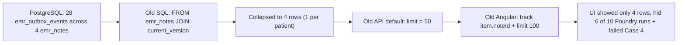
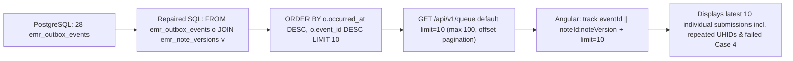

# Apollo Stage 13 — Top 10 Live Extraction Queue Root Cause Analysis

**Date:** 25 November 2026  
**Scope:** Full-stack diagnosis and permanent repair of the 4-row queue collapse defect in `D:\AI Extraction`  
**Status:** Resolved & Verified (Zero new paid Foundry calls)

---

## 1. Executive Summary

Following the 10 live paid Microsoft Foundry (`gpt-6.1-sol`) clinical extraction runs on 25 November 2026, the Angular Clinical Extraction Queue displayed only **4 rows** (`P100234`, `P100237`, `P100235`, `P100236`) instead of the **10 most recent individual clinical extraction submissions**.

Inspection of PostgreSQL (`cx_platform`), the ASP.NET Core backend ([EmrStore.cs](file:///d:/AI%20Extraction/backend/Emr/EmrStore.cs), [EmrEndpoints.cs](file:///d:/AI%20Extraction/backend/Emr/EmrEndpoints.cs)), and the Angular frontend ([clinical-queue.ts](file:///d:/AI%20Extraction/frontend/src/app/queue/clinical-queue.ts), [clinical-queue.html](file:///d:/AI%20Extraction/frontend/src/app/queue/clinical-queue.html)) revealed a **multi-layer root cause** across database projection, API defaults, and frontend list identity tracking.

---

## 2. Database Ground Truth (Before & After Repair)

Direct inspection of PostgreSQL `cx_platform` proved that all submission history was durably persisted and untouched:

| Table | Verified Row Count | Meaning |
| --- | ---: | --- |
| `emr_patients` | 4 | `P100234`, `P100235`, `P100236`, `P100237` |
| `emr_encounters` | 4 | `ENC-100567`, `ENC-100568`, `ENC-100569`, `ENC-100570` |
| `emr_notes` | 4 | One mutable parent note record per encounter (`current_version` = latest version) |
| `emr_note_versions` | 57 | Immutable version snapshots across drafts and signed revisions |
| `emr_outbox_events` | **28** | **28 individual signed note extraction submission events** (including all 10 Foundry runs) |
| `emr_extraction_links` | 26 | Extraction run linkages (`event_id -> extraction_id`); failed Case 4 intentionally has no row |

Because there were only **4 rows in `emr_notes`** (one per synthetic patient/encounter), any query rooted at `FROM emr_notes` could return **at most 4 rows** regardless of how many individual extraction events were submitted.

---

## 3. Exact Multi-Layer Root Cause



### Layer 1 — Primary Defect: Backend SQL Projection Collapsed Submissions Per Note
In [EmrStore.cs](file:///d:/AI%20Extraction/backend/Emr/EmrStore.cs), `QueueItems(...)` previously queried:

```sql
FROM emr_notes n
JOIN emr_encounters e ON e.id = n.encounter_id
JOIN emr_patients p ON p.id = e.patient_id
JOIN emr_encounter_assignments a ON a.encounter_id = e.id
LEFT JOIN emr_note_versions v ON v.note_id = n.id AND v.version = n.current_version
LEFT JOIN emr_outbox_events o ON o.note_id = n.id AND o.note_version = n.current_version
LEFT JOIN emr_extraction_links l ON l.note_id = n.id AND l.note_version = n.current_version
```

Consequences:
1. **Collapsed 28 individual extraction events into 4 rows** (one per `emr_notes` row / patient encounter).
2. **Hid earlier signed versions for the same UHID** (e.g., `P100234` had 4 live Foundry submissions: `v21`, `v23`, `v25`, `v27`, yet only `v27` appeared).
3. **Completely hid failed Case 4 (`P100234 v23`, `AZURE_INVALID_EVIDENCE`)** because `P100234` was later updated to `v25` and `v27`.
4. **Included `P100236` (an older/non-Foundry note)** inside the 4 visible rows while hiding 6 of the 10 live Foundry cases.

### Layer 2 — Secondary Defect: API Default Limit
In [EmrEndpoints.cs](file:///d:/AI%20Extraction/backend/Emr/EmrEndpoints.cs), `GET /api/v1/queue` previously defaulted `limit` to `50` instead of `10`.

### Layer 3 — Secondary Defect: Angular Tracking Key, Limit, and Background Polling Identity
1. **[clinical-queue.html](file:///d:/AI%20Extraction/frontend/src/app/queue/clinical-queue.html):** `@for (item of queueItems(); track item.noteId)` tracked rows solely by `item.noteId`. Once multiple signed versions of the same note (`P100234 v27, v25, v23, v21`) appeared in the Top 10 list, tracking by `noteId` caused Angular DOM identity collisions (`NG0955` duplicate track keys).
2. **[clinical-queue.ts](file:///d:/AI%20Extraction/frontend/src/app/queue/clinical-queue.ts):** Requested `limit: 100` instead of `limit: 10`, and matched background poll sync against `noteId` without enforcing exact `(noteId, noteVersion, patientReference)` and `eventId`.

---

## 4. Repaired Architecture



### Summary of Code Fixes
1. **[EmrStore.cs](file:///d:/AI%20Extraction/backend/Emr/EmrStore.cs#L76-L164):** Re-rooted `QueueItems` on `FROM emr_outbox_events o` joined strictly on `(o.note_id, o.note_version)` to `emr_note_versions v`, `emr_notes n`, `emr_encounters e`, `emr_patients p`, `emr_encounter_assignments a`, and `LEFT JOIN emr_extraction_links l ON l.event_id = o.event_id` + `LEFT JOIN extraction_runs r ON r.extraction_id = l.extraction_id`.
   - Orders deterministically by `received_at DESC, event_id DESC`.
   - Preserves failed events (`l.extraction_id IS NULL`) with `queueState = 'Failed'` and `error = COALESCE(o.processing_error, o.last_error)`.
   - Prevents row duplication across 1-to-many tables (`emr_outbox_events.event_id` is the primary key; `emr_extraction_links.event_id` is 1:1).
2. **[EmrEndpoints.cs](file:///d:/AI%20Extraction/backend/Emr/EmrEndpoints.cs#L58-L64):** Changed default `limit` on `GET /api/v1/queue` to `10` (`limit ?? 10`), clamped `1..100`, with full `offset` pagination.
3. **[OpenApiEndpoints.cs](file:///d:/AI%20Extraction/backend/Configuration/OpenApiEndpoints.cs):** Updated OpenAPI 3.0.3 contract documentation for `/api/v1/queue`.
4. **[clinical-queue.ts](file:///d:/AI%20Extraction/frontend/src/app/queue/clinical-queue.ts), [clinical-queue.html](file:///d:/AI%20Extraction/frontend/src/app/queue/clinical-queue.html), [clinical-queue.scss](file:///d:/AI%20Extraction/frontend/src/app/queue/clinical-queue.scss):**
   - Polls `limit: 10`.
   - Tracks list rows by `item.eventId || (item.noteId + ':' + item.noteVersion)`.
   - Renders subtle encounter + version metadata (`ENC-100567 · v27`) so repeated UHID rows are cleanly distinguishable without adding clutter.
   - Displays a minimal 7px muted red dot (`.failed-job-dot`) for failed rows and truthfully displays `Extraction failed` + `AZURE_INVALID_EVIDENCE` with zero fabricated tables when Case 4 (`P100234 v23`) is selected.

---

## 5. Verification Outcome

- `GET http://127.0.0.1:5000/api/v1/queue` (default `limit=10`) returns **`Total=28, Returned=10`**, matching all **10 live Foundry extraction events** (`Case 10` down to `Case 1`), including 4 versions of `P100234`, 3 versions of `P100235`, 3 versions of `P100237`, and failed Case 4 (`P100234 v23`).
- Verified visually via Playwright screenshots in [`docs/stage13-evidence/screenshots/`](file:///d:/AI%20Extraction/docs/stage13-evidence/screenshots/01-top10-queue-entries.png) and automated unit/integration/E2E test suites.
