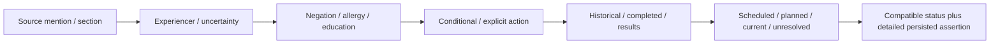

# Stage 15 assertion and temporality

Recognition, clinical action, assertion and terminology are separate decisions. V2 prioritizes experiencer and explicit uncertainty/negation/allergy/education/conditional language before section defaults. Shared leading cues can apply to a coordinated list; unrelated drug attributes cannot. Result markers are inspected after the test in its own scope. Appointment dates/times before a test are not laboratory values.

| Medication detailed assertion | Compatible assertionStatus |
|---|---|
| current / continued | current_medication |
| new | new_order |
| held | held |
| discontinued | discontinued |
| historical / completed_course | historical |
| negated | negated |
| allergy | allergy |
| conditional / planned | conditional |
| uncertain / educational / other_experiencer / monitoring | uncertain |

| Investigation detailed assertion | Compatible assertionStatus |
|---|---|
| newly_ordered / planned / scheduled | new_order |
| completed / historical / result_documented | historical |
| conditional | conditional |
| negated | negated |
| uncertain / other_experiencer | uncertain |

The detailed value and temporality are saved in `provenance.clinicalContext`; source section, exact mention span and timing are saved alongside it. These are additive fields; no existing `new_order` or `historical` value is silently redefined. Angular renders the persisted detailed assertion when present. Missing dates are not invented, dates are not converted using an assumed encounter clock, and old source events are not automatically new prescriptions.

`Report ... on 01/12/2026 at 09:00 AM for CBC` becomes scheduled; `CBC performed yesterday showed ...` becomes a result documented in the past; `Repeat CBC if/when fever recurs` remains conditional; `No repeat CT scan required` remains negated. Completed antibiotics remain distinct from current therapy. PRN wording such as `when required` is retained without treating every PRN instruction as a future activation condition.

## Executed coarse confusion matrices

Rows are draft source labels; columns are emitted compatible statuses. `<missed>` includes detection failures. `<no_gold>` includes strict false positives caused by incomplete original mention labels. These matrices and per-class rates are engineering evidence, not a claim of independently demonstrated perfect assertion accuracy.

### stage5_independent_benchmark_35cases.json: medications, original-frozen

| Gold / predicted | <missed> | allergy | current_medication | discontinued | new_order |
|---|---|---|---|---|---|
| allergy | 0 | 4 | 0 | 0 | 0 |
| conditional | 2 | 0 | 0 | 0 | 0 |
| current_medication | 4 | 0 | 22 | 0 | 0 |
| discontinued | 2 | 0 | 0 | 2 | 0 |
| historical | 2 | 0 | 0 | 0 | 0 |
| new_order | 6 | 0 | 0 | 0 | 44 |

### stage5_independent_benchmark_35cases.json: medications, integrated

| Gold / predicted | allergy | conditional | current_medication | discontinued | historical | negated | new_order |
|---|---|---|---|---|---|---|---|
| <no_gold> | 0 | 0 | 0 | 0 | 0 | 1 | 0 |
| allergy | 4 | 0 | 0 | 0 | 0 | 0 | 0 |
| conditional | 0 | 2 | 0 | 0 | 0 | 0 | 0 |
| current_medication | 0 | 0 | 26 | 0 | 0 | 0 | 0 |
| discontinued | 0 | 0 | 0 | 4 | 0 | 0 | 0 |
| historical | 0 | 0 | 0 | 0 | 2 | 0 | 0 |
| negated | 0 | 0 | 0 | 0 | 0 | 0 | 0 |
| new_order | 0 | 0 | 0 | 0 | 0 | 0 | 50 |

Per-class integrated results:

| Class | TP | FP | FN | Precision | Recall |
|---|---|---|---|---|---|
| allergy | 4 | 0 | 0 | 100.00% | 100.00% |
| conditional | 2 | 0 | 0 | 100.00% | 100.00% |
| current_medication | 26 | 0 | 0 | 100.00% | 100.00% |
| discontinued | 4 | 0 | 0 | 100.00% | 100.00% |
| historical | 2 | 0 | 0 | 100.00% | 100.00% |
| negated | 0 | 1 | 0 | 0.00% | N/A |
| new_order | 50 | 0 | 0 | 100.00% | 100.00% |

### stage5_independent_benchmark_35cases.json: investigations, original-frozen

| Gold / predicted | <missed> | conditional | historical | new_order |
|---|---|---|---|---|
| <no_gold> | 0 | 0 | 0 | 1 |
| conditional | 0 | 3 | 0 | 0 |
| historical | 0 | 0 | 6 | 0 |
| new_order | 4 | 0 | 0 | 66 |

### stage5_independent_benchmark_35cases.json: investigations, integrated

| Gold / predicted | <missed> | conditional | historical | new_order |
|---|---|---|---|---|
| <no_gold> | 0 | 0 | 0 | 1 |
| conditional | 0 | 3 | 0 | 0 |
| historical | 0 | 0 | 6 | 0 |
| new_order | 1 | 0 | 0 | 69 |

Per-class integrated results:

| Class | TP | FP | FN | Precision | Recall |
|---|---|---|---|---|---|
| conditional | 3 | 0 | 0 | 100.00% | 100.00% |
| historical | 6 | 0 | 0 | 100.00% | 100.00% |
| new_order | 69 | 1 | 1 | 98.57% | 98.57% |

### stage15_frozen_cases.json: medications, original-frozen

| Gold / predicted | <missed> | current_medication | discontinued | historical | negated | new_order |
|---|---|---|---|---|---|---|
| allergy | 0 | 1 | 0 | 0 | 0 | 0 |
| conditional | 2 | 0 | 0 | 0 | 0 | 0 |
| current_medication | 7 | 4 | 0 | 0 | 0 | 0 |
| discontinued | 0 | 0 | 2 | 0 | 0 | 0 |
| held | 2 | 0 | 0 | 0 | 0 | 0 |
| historical | 0 | 2 | 0 | 1 | 0 | 0 |
| negated | 0 | 0 | 0 | 0 | 3 | 0 |
| new_order | 5 | 0 | 0 | 0 | 0 | 3 |
| uncertain | 1 | 2 | 0 | 0 | 0 | 0 |

### stage15_frozen_cases.json: medications, integrated

| Gold / predicted | allergy | conditional | current_medication | discontinued | held | historical | negated | new_order | uncertain |
|---|---|---|---|---|---|---|---|---|---|
| allergy | 1 | 0 | 0 | 0 | 0 | 0 | 0 | 0 | 0 |
| conditional | 0 | 2 | 0 | 0 | 0 | 0 | 0 | 0 | 0 |
| current_medication | 0 | 0 | 11 | 0 | 0 | 0 | 0 | 0 | 0 |
| discontinued | 0 | 0 | 0 | 2 | 0 | 0 | 0 | 0 | 0 |
| held | 0 | 0 | 0 | 0 | 2 | 0 | 0 | 0 | 0 |
| historical | 0 | 0 | 0 | 0 | 0 | 3 | 0 | 0 | 0 |
| negated | 0 | 0 | 0 | 0 | 0 | 0 | 3 | 0 | 0 |
| new_order | 0 | 0 | 0 | 0 | 0 | 0 | 0 | 8 | 0 |
| uncertain | 0 | 0 | 0 | 0 | 0 | 0 | 0 | 0 | 3 |

Per-class integrated results:

| Class | TP | FP | FN | Precision | Recall |
|---|---|---|---|---|---|
| allergy | 1 | 0 | 0 | 100.00% | 100.00% |
| conditional | 2 | 0 | 0 | 100.00% | 100.00% |
| current_medication | 11 | 0 | 0 | 100.00% | 100.00% |
| discontinued | 2 | 0 | 0 | 100.00% | 100.00% |
| held | 2 | 0 | 0 | 100.00% | 100.00% |
| historical | 3 | 0 | 0 | 100.00% | 100.00% |
| negated | 3 | 0 | 0 | 100.00% | 100.00% |
| new_order | 8 | 0 | 0 | 100.00% | 100.00% |
| uncertain | 3 | 0 | 0 | 100.00% | 100.00% |

### stage15_frozen_cases.json: investigations, original-frozen

| Gold / predicted | <missed> | conditional | historical | negated | new_order |
|---|---|---|---|---|---|
| <no_gold> | 0 | 0 | 0 | 0 | 2 |
| conditional | 0 | 1 | 0 | 0 | 0 |
| historical | 6 | 0 | 1 | 0 | 1 |
| negated | 0 | 0 | 0 | 1 | 0 |
| new_order | 13 | 0 | 1 | 0 | 18 |
| uncertain | 1 | 0 | 0 | 0 | 0 |

### stage15_frozen_cases.json: investigations, integrated

| Gold / predicted | conditional | historical | negated | new_order | uncertain |
|---|---|---|---|---|---|
| conditional | 1 | 0 | 0 | 0 | 0 |
| historical | 0 | 8 | 0 | 0 | 0 |
| negated | 0 | 0 | 1 | 0 | 0 |
| new_order | 0 | 0 | 0 | 32 | 0 |
| uncertain | 0 | 0 | 0 | 0 | 1 |

Per-class integrated results:

| Class | TP | FP | FN | Precision | Recall |
|---|---|---|---|---|---|
| conditional | 1 | 0 | 0 | 100.00% | 100.00% |
| historical | 8 | 0 | 0 | 100.00% | 100.00% |
| negated | 1 | 0 | 0 | 100.00% | 100.00% |
| new_order | 32 | 0 | 0 | 100.00% | 100.00% |
| uncertain | 1 | 0 | 0 | 100.00% | 100.00% |

Detailed-class matrices for the subset with explicit fine labels are retained in `metrics.json` under `detailedConfusionMatrix`. The legacy schema cannot represent those distinctions; this is recorded as `<not_represented>`, rather than assigning it invented detailed labels. Other detailed classes have regression assertions but no independent clinical accuracy estimate.

Remaining uncertainty: clause/tense heuristics do not establish general temporal reasoning, reference dates are not fully normalized, wrapped/multi-sentence instructions and changes over multiple visits may require review.
