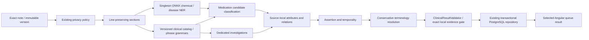

# Stage 15 clinical extraction architecture

`CandidateV2` is an opt-in clinical pipeline around the existing, pinned BC5CDR ONNX model. The backend, PostgreSQL, Foundry contracts, Azure Service Bus integration and Angular queue are retained. `LocalOnnx:PipelineVersion` defaults to `Legacy`; no production promotion is implied by synthetic test results.

The platform extraction workflow still rejects empty and over-65,536-character notes and enforces `ZeroLeakageValidator`. The Development synthetic exception requires existing, server-verified provenance; no new exemption, public debug endpoint, permission bypass, or real-patient test fixture was introduced. The NLP components do not rewrite or flatten the inference text. Offsets use .NET UTF-16 code units, matching JavaScript string offsets.

The upgraded path uses `ClinicalSectionDetector`, `MedicationCandidateClassifier`, `InvestigationRecognizer`, `MedicationAttributeExtractor`, `ClinicalAssertionClassifier`, `VersionedClinicalTerminology` and `LocalEvidenceValidator`. `LocalClinicalScope` supplies shared span bounds rather than an additional NLP runtime. These components are deterministic, testable C# around one learned NER component. No Python production dependency was added.

The original methods in `ClinicalPipelineService` remain the legacy path. `ProcessPlatformExtraction` selects the version through options; the local provider and `/v1/ner/predict` use that selection. Foundry's strict `ClinicalCandidate` schema and validator mapping remain separate. `ClinicalResultValidator.ValidateLocal` checks the additive local contract; it does not send local results through an incompatible Foundry candidate schema.

The existing medication/investigation fields retain their roles. Additive `provenance.clinicalContext` carries the detailed assertion, temporality, section, exact mention offsets, detection method, nullable raw NER score, attribute evidence, administration method, explicit start/stop timing, PRN indication and documented chemotherapy schedule. Existing `assertionStatus` remains compatible: e.g. scheduled investigations have `new_order` plus detailed `scheduled`; completed medication courses have `historical` plus `completed_course`. No high neural score establishes an order.

Persistence now writes and reloads the existing `origin`, `provenance_json`, `normalization_json`, `clinical_category` and `result_value` columns. Older rows with no saved JSON retain the legacy read fallback. No application migration or historical row rewrite was performed. Exact patient/encounter/note-version association still comes from immutable EMR links and event identity, outside the stateless NLP components.

Candidate tracing is request-scoped in `OnnxExecutionReceipt.CandidateTraces`. It covers detection, lexical rejection, catalog overlap, context signals, accepted mentions, ambiguity, unresolved terminology and final assertions. These source-bearing traces are captured only by the offline synthetic developer harness. Ordinary application logs and public model metadata do not receive the trace list. Accepted entities expose concise provenance through the existing authorized extraction API.

V2 windows have 510 content tokens plus CLS/SEP, stride 448, and 62 content-token overlap. Each content token receives positive blended coverage; decoded spans retain original offsets. Legacy 512-token slicing remains reproducible. There is no model-session creation per note. Per-run ONNX cancellation options, a provider timeout, integrity checks and output-shape checks fail closed.

Remaining limits include incomplete multi-line attribute linking, heuristic language scope, limited English clinical abbreviations, unresolved external codes and no independently adjudicated clinical release assessment. See the benchmark, safety and final evaluation reports.
