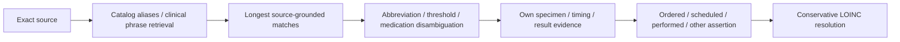

# Stage 15 investigation extraction redesign

BC5CDR's learned chemical/disease task does not supply a general investigation class. `InvestigationRecognizer` is an independent module using an immutable, versioned catalog plus clinical phrase grammars. No new trained investigation model or fabricated LOINC release is claimed.

The catalog carries inherited aliases and new authored recognition phrases. Coverage includes hematology counts and smear, common biochemistry panels, cultures, marrow aspirate/biopsy, cytogenetics, flow cytometry, mutation testing, pathology, imaging and procedures. Productive grammars recover specimen-plus-culture/cytology, count, biopsy/aspiration and selected assay phrases. Recognition does not require a successful standard-code lookup.

Imaging region expansion uses bounded anatomical terms; it does not consume arbitrary narrative words. Explicit high-resolution, contrast and dose qualifiers remain inside the source mention. Troponin subtype recognition preserves the documented subtype. A short `CT` without diagnostic context, and nonclinical abbreviation use, is rejected with an internal trace.

Medication administration takes precedence over a conflicting analyte substring when justified by the source. `Give potassium 10 mEq IV` is not a serum-potassium test; a reference to a diagnostic threshold does not become a medication when its investigation candidate is suppressed. No default specimen is added to an unqualified laboratory mention.

Appointments are detected through instruction language and exact dates before or after the mention. `Report on 01/12/2026 for CBC and renal function tests` retains future scheduled assertions. Result detection inspects the entity's result scope, not a colon anywhere in the sentence; `09:00 AM` before CBC cannot be taken as its result. Conditions and negations remain distinct from orders.

The original AML source says `renal/liver function panel`. V2 retains that exact combined mention, with unresolved terminology, rather than inventing two separately worded tests. The report distinguishes its literal wording from the audit target phrases. Marrow and culture findings in the hospital course are retained as performed/result mentions, not new orders.

Broad CBC, renal/liver panels, unqualified imaging, and culture-plus-susceptibility requests do not acquire overly specific codes. The existing verified lookup snapshot may supply candidates; a candidate is not an approved exact match. In particular, culture identification alone does not encode an additional sensitivity test.

Limitations include finite phrase/alias coverage, some unrecognized abbreviations, incomplete narrative result parsing and no independently validated LOINC mapping accuracy. A fully qualified `Chest X-ray (PA view)` differs from the shorter original benchmark label; strict scoring preserves that mismatch. See the executed ablation metrics rather than treating every newly recognized phrase as validated coverage.
