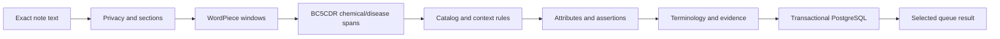

# Stage 15 Local ONNX forensic audit

Baseline captured before extraction behavior edits, 25 November 2026. Existing working-tree changes are preserved in `stage15-evidence/baseline/pre-existing-working-tree.txt`. Exact original clinical, NLP, contract, security and persistence sources and SHA-256 hashes are in `stage15-evidence/baseline/source/` and `source-manifest.json`. Do not overwrite this evidence.

The original real ONNX 35-case run produced medication TP=72, FP=0, FN=16 (precision 1.000, recall 0.8182, F1 0.9000); investigations TP=75, FP=1, FN=4 (precision 0.9868, recall 0.9494, F1 0.9677). Evidence offsets were exact for 148/148 emitted entities. These are frozen, engineering-authored synthetic development labels, not independently validated clinical ground truth. Command, TRX and full numerators are in `stage15-evidence/baseline/`.

| Stage | Actual original path and behavior | Loss or risk; original tests |
|---|---|---|
| Input / privacy | `ExtractionWorkflow.ExtractAndSaveAsync` rejects empty / >65,536 characters; `ZeroLeakageValidator` runs before inference except server-verified Development synthetic policy | No permission to weaken screening; security tests exist |
| Preprocessing / sections | Original text is retained; `ContextEngine.SegmentSections` uses heading regexes | Numbered headings and chemotherapy / follow-up sections incompletely recognized; offsets remain UTF-16 |
| Tokenization | Pinned 20,000-entry WordPiece tokenizer, lowercased pieces with original character offsets | Does not implement every Hugging Face normalizer behavior; Unicode parity needs testing |
| ONNX | Singleton verified INT8 artifact, 512-token windows, stride 448, logits blended in overlaps | Full document is iterated, but interior windows originally lack their own CLS/SEP; no request cancellation inside inference |
| Labels / decoding | Nine output labels; chemical/disease labels renamed MEDICATION/CONDITION; BIO repair and word reconstruction | Chemical is not a prescription; dosage/site output slots are not proof of trained capability; decode-time lexical rejections are not traced |
| Investigation candidates | `ClinicalPipelineService.CollectAndFilterSpans`, lines 39-73 in frozen original, loops `KnownLabTerms`; `InvestigationMentionRules` adds limited productive phrases | No general investigation NER; marrow, plural cultures and panels are missed |
| Medication candidates | Catalog recovery precedes ONNX spans; original lines 174-187 require confidence >=0.85 AND `ExplicitRxPrefixRegex` for unmatched drugs | `NO_EXPLICIT_PRESCRIPTION_PREFIX` rejects legitimate dose/route-supported chemicals; threshold not validated for Apollo clinical decisions |
| Context | `ContextEngine.Classify` and original pipeline assertion ternary | Scheduled CBC with an appointment time can match numeric-result colon regex; conditional/historical/uncertain distinctions collapse; section context incomplete |
| Attributes / relations | `PosologyBinder` uses `ClinicalScope.AttributesForEntity` and nearest regex | mg/m2 is reduced to mg strength; concentration and administered quantity need separate treatment; entity scope can cross lines |
| Terminology | Small frozen C# masters plus mutable learned dictionaries; verification snapshot gates final codes | A missing code blocks unmatched ONNX candidates before clinical context; brand/code specificity already sometimes withheld |
| Evidence | Foundry `ClinicalResultValidator.Verify` verifies quotes and occurrence, then attributes; local pipeline directly constructs evidence | Local and Foundry must retain exact validation; local path needs an independent evidence pass, not a Foundry bypass |
| Persistence | Transactional immutable parent insert; child rows and routing metadata saved | Existing `origin`, `provenance_json`, `normalization_json` columns were created but not populated/read; reload reconstructs provenance and normalization from current rules rather than original result |
| UI | Queue reads selected persisted extraction and provider metadata | Must render retained mentions and their assertions without frontend extraction rules |

The ONNX format executes inference; the model task, training domain, downstream filtering, and assertion/attribute rules determine clinical coverage. No alternative model has yet been benchmarked. Further measured results and exact AML investigation will be appended after implementation.
