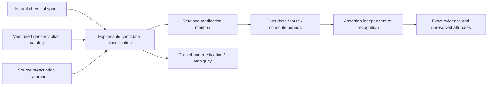

# Stage 15 medication extraction redesign

The frozen legacy filter rejected unmatched neural chemicals unless both an arbitrary 0.85 score gate and a narrow prescription-prefix regex passed. It also mixed catalog membership with whether a medication was ordered. `CandidateV2` removes that gate from its recognition path; the original implementation remains available as `Legacy`.

Candidates combine actual ONNX outputs, recognition aliases and a productive dose-supported prescription grammar. Dose/strength, route, schedule, section, action and assertion cues are recorded separately. Catalog rules have no invented NER probability. A low or high model score is diagnostic information, not a calibrated probability that treatment was prescribed. No clinical cutoff was fitted to the development cases; an independently annotated threshold-validation set is unavailable.

Diagnostic analytes, thresholds, known molecular/pathology findings, non-therapeutic chemicals and grammatical action/form words are rejected with reasons. Analyte names used as actual administered salts are distinguished using immediate dose and therapeutic-action context. Known medications in drug-level monitoring are retained as non-active mentions. Unknown bare chemical mentions without a supported clinical action remain uncertain. Allergy, negation, education, another person's medication and historical treatment do not become active prescriptions.

Attribute extraction partitions each sentence/line at other entity mentions and independent action verbs. Shared leading actions can apply to coordinated lists; another drug's dose cannot. Every populated medication attribute has an exact supporting source span, checked independently against the entity's permitted attribute bounds.

`strength` represents a documented product strength/concentration; `dose` represents the administered amount. For `Metformin 500 mg, 1 tablet PO`, these are `500 mg` and `1 tablet`. For `Acyclovir 400 mg PO twice daily`, `dose` is `400 mg` and product strength remains missing. This corrects the legacy tendency to label every mass as strength. The unchanged 35-case labels sometimes expect the old interpretation, so its strength score falls; those errors remain visible in the report rather than relabeling gold to improve scores.

Concentration is preserved as strength, e.g. `100 mg/mL`, separately from an administered `5 mL`. Laboratory `mg/dL` values cannot be shortened into administered milligrams. IU, units, mass, volume and form quantities are handled separately. Unclear changing regimens remain subject to `ClinicalReview` and incomplete/complex prescription findings.

For `Cytarabine 100 mg/m2 continuous IV infusion (Days 1-7)`, dose stays `100 mg/m2`, route `IV`, administration `continuous infusion`, and schedule `Days 1-7`. For the adjacent Daunorubicin entry, `60 mg/m2`, `IV push` and its own days stay separate. Neither absolute milligrams nor an inferred duration is calculated. The original AML note's future Cytarabine consolidation planning remains a separate planned mention with no invented dose.

Frequency normalization handles unambiguous daily/BID/TID/QID, fixed-hour, weekly, bedtime and PRN patterns. Explicit intervals with PRN retain their wording. Source schedules, date timing and PRN indication are additive context fields; missing attributes remain null. Variable schedules, cross-line wrapping and complex treatment-event interpretation remain incomplete. The module does not interpret a named oncology regimen into undocumented drug orders.

The frozen 47-case draft suite and separate safety challenges exercise prefix recovery, false-positive prevention, concentration/dose separation, chemotherapy units and days, differing adjacent doses, missing attributes, similar names, ambiguity, monitoring, cancellation and long notes. They are engineering regression evidence, not independent clinical validation.
