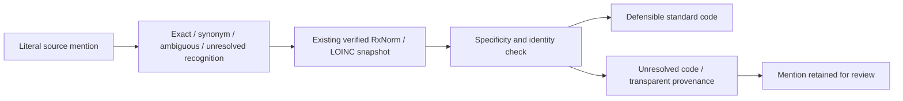

# Stage 15 terminology normalization

`Clinical/Terminology/clinical-recognition-v1.json` is a versioned recognition resource, loaded once into immutable indexes and compiled matchers. It is separate from approval of RxNorm and LOINC identifiers. `build-stage15-catalog.py` documents how inherited aliases and locally authored phrases were assembled and refuses to overwrite an existing snapshot.

Recognition outcomes appear as additive `normalization.matchType`. Existing `normalization.status` continues to distinguish matched, uncertain and unmatched standard normalization. Canonical recognition text may be available while the standard identifier remains unresolved. Neither a drug catalog hit nor high NER confidence creates an ingredient, formulation or product-strength identity.

The existing numeric normalization confidence is a legacy heuristic, not a calibrated clinical probability. V2's nullable raw NER score is the unchanged decoded neural score, also not a probability of a medication order. Rule-only detections have no invented NER score.

The resource includes generics, inherited Indian brand aliases, synonyms and investigation phrases. An ambiguous brand such as Glycomet GP has no asserted ingredient display or final RxCUI in V2. Unverified brand mappings remain uncertain. New oncology recognition entries were not assigned guessed RxCUIs. Broad investigations do not inherit specimen/method/view assumptions from an attractive lookup result.

V2 also checks the documented ingredient against the verified concept name without removing salt/ester suffixes. A documented prednisolone acetate mention cannot silently become an exact base-prednisolone code; the broader candidate is withheld and the original ingredient wording remains available.

Standard-code approval continues to use the existing `TerminologyVerification` snapshot. Its release identifiers and mapping notes are retained in each result. This is a pinned subset, not a current or complete RxNorm/LOINC distribution. Runtime extraction makes no terminology network request. The attempted public RxNav fetch was unavailable from the shell environment; no new external-code snapshot was imported and no missing code was fabricated.

NLM explains that normalized RxNorm names/codes are public-domain content, while full releases also contain proprietary source data and require a free UMLS license. This implementation carries forward the project's existing verified subset and attributes its provenance; it does not assert licensing clearance for arbitrary third-party drug masters. [NLM RxNorm terms](https://www.nlm.nih.gov/research/umls/rxnorm/docs/termsofservice.html).

LOINC permits use under its license, including commercial use; free access does not remove its license conditions or semantic mapping requirements. No complete LOINC download or newly redistributed code set was added. [LOINC license](https://loinc.org/license).

NLM's RxTerms is another possible future ingestion source, especially for drug-name/route/strength separation, but it is tailored to US prescribing and is not a comprehensive Indian-brand master. It was researched, not imported or benchmarked here. [NLM RxTerms](https://lhncbc.nlm.nih.gov/LHC-research/LHC-projects/health-information/RxTerms.html).

Saved normalization JSON now survives PostgreSQL reload. Historical rows lacking that JSON keep the existing fallback behavior; no stored evidence or standard code was rewritten. Mapping coverage and unresolved rates are measured separately in the benchmark. An identifier existing in the lookup snapshot is not proof that it is clinically the correct mapping. Correct mapping rate against independently adjudicated reference codes remains NOT MEASURED.
