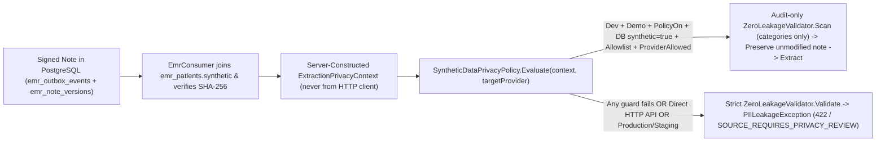

# Apollo Clinical Extraction — Development-Only Synthetic Data Privacy Gate

**Date:** 25 November 2026  
**Scope:** Backend-verified synthetic-data provenance policy for `ZeroLeakageValidator` / `EmrConsumer` / `ExtractionWorkflow`  
**Status:** Implemented & Verified (`21/21` backend xUnit tests PASS, Angular Submit Test Note E2E PASS, Swagger/Postman PASS, zero paid Foundry calls)

---

## 1. Problem Statement & Security Objective

Previously, `ExtractionWorkflow` and `ClinicalPipelineService` unconditionally ran `ZeroLeakageValidator.Validate(noteText)` on every clinical note, causing realistic fictional synthetic test notes (containing fictional demographic headers, patient names, synthetic UHIDs, clinician names, or fictional emergency contacts) to fail with `SOURCE_REQUIRES_PRIVACY_REVIEW` in `EmrConsumer`.

This implementation introduces a **strictly development-only, backend-verified synthetic-data privacy policy** ([SyntheticDataPrivacyPolicy.cs](file:///d:/AI%20Extraction/backend/Security/SyntheticDataPrivacyPolicy.cs)) that:
- Permits realistic fictional identifiers **only** when the backend independently proves from PostgreSQL that the signed note belongs to an authorized synthetic test dataset in `Development`.
- **Never** trusts any client-supplied `isSynthetic` JSON field, query parameter, or HTTP header.
- Preserves strict fail-closed `ZeroLeakageValidator.Validate` protection for all real, unknown, unallowlisted, direct-API, or non-Development clinical records.
- Keeps the complete original synthetic note unmodified in PostgreSQL and Angular, and leaves `ClinicalResultValidator` (`AZURE_INVALID_EVIDENCE`) and Azure Service Bus asynchronous processing completely unchanged.

---

## 2. Authorization Boundary & Trust Flow



### Mandatory Fail-Closed Conditions (ALL Must Pass Simultaneously)
Evaluated inside [SyntheticDataPrivacyPolicy.cs](file:///d:/AI%20Extraction/backend/Security/SyntheticDataPrivacyPolicy.cs):

1. **Host Environment:** `IHostEnvironment.IsDevelopment()` must be `true`. (`Staging` and `Production` **always** deny with `STRICT_ENVIRONMENT_NOT_DEVELOPMENT`, regardless of configuration flags.)
2. **Local Demo Gate:** `ClinicalApiSecurity.IsDemo(configuration, environment)` (`Security:LocalDemoMode == true` + `Development`) must be `true`.
3. **Explicit Policy Opt-In:** `Security:SyntheticData:AllowAuthorizedSyntheticIdentifiers` must be `true` (default `false` in [appsettings.json](file:///d:/AI%20Extraction/backend/appsettings.json)).
4. **Backend Database Provenance:** `ExtractionPrivacyContext` must be server-constructed by [EmrMessaging.cs](file:///d:/AI%20Extraction/backend/Emr/EmrMessaging.cs#L64-L98) from PostgreSQL (`emr_patients.synthetic == true`, valid `patient_id`, `patient_reference`, `encounter_id`, `note_id`, `note_version`, `event_id`, and verified `SHA-256` `source_hash`). Direct endpoints (`/api/v1/extractions`, `/v1/ner/predict`) never supply verified synthetic provenance and always enforce strict PII blocking.
5. **Authorized Synthetic Dataset Allowlist:** When `Security:SyntheticData:AllowedPatientReferences` is configured (non-empty), `emr_patients.reference` must match an entry in the allowlist (case-insensitive). In [appsettings.Development.json](file:///d:/AI%20Extraction/backend/appsettings.Development.json), this is explicitly restricted to the 4 seeded synthetic test patients (`P100234`, `P100235`, `P100236`, `P100237`).
6. **External Cloud Provider Gate:** When `targetProvider` is `MicrosoftFoundry`, `Security:SyntheticData:AllowExternalFoundryForVerifiedSynthetic` must also be `true` (default `false` in [appsettings.json](file:///d:/AI%20Extraction/backend/appsettings.json)). Even when enabled in Development, it applies **only** to backend-verified synthetic dataset records — never to real or unverified clinical text.

---

## 3. Configuration Reference

### Production / Default ([appsettings.json](file:///d:/AI%20Extraction/backend/appsettings.json)) — Disabled by Default
```json
"Security": {
  "LocalDemoMode": false,
  "SyntheticData": {
    "AllowAuthorizedSyntheticIdentifiers": false,
    "AllowExternalFoundryForVerifiedSynthetic": false,
    "AllowedPatientReferences": []
  }
}
```

### Local Development ([appsettings.Development.json](file:///d:/AI%20Extraction/backend/appsettings.Development.json)) — Scoped to Seeded Synthetic Patients
```json
"Security": {
  "LocalDemoMode": true,
  "SyntheticData": {
    "AllowAuthorizedSyntheticIdentifiers": true,
    "AllowExternalFoundryForVerifiedSynthetic": true,
    "AllowedPatientReferences": [
      "P100234",
      "P100235",
      "P100236",
      "P100237"
    ]
  }
}
```

### Structured Privacy Audit Logging (Zero Raw PII Logged)
When a verified synthetic note with fictional identifiers is permitted, [ExtractionWorkflow.cs](file:///d:/AI%20Extraction/backend/Clinical/ExtractionWorkflow.cs#L43-L55) invokes `ZeroLeakageValidator.Scan(noteText)` and logs **only** non-sensitive metadata (`PolicyReason`, `Provider`, `PatientRef`, `EventId`, and detected identifier category labels such as `NAME,MRN,PHONE`). Raw names, phone numbers, or note text are never written to logs.

---

## 4. Verification & Test Coverage

| Test Suite / Check | Result | What Was Proven |
| --- | --- | --- |
| `SyntheticDataPrivacyGateTests.Policy_PermitsVerifiedSyntheticInDevelopment_AndFailsClosedForProductionRealOrUnverified` | **PASS** | Verifies all 6 fail-closed gates (`Production`, `Staging`, `LocalDemoMode=false`, `AllowAuthorizedSyntheticIdentifiers=false`, `Unverified`, `DatabaseSyntheticFlag=false`, unallowlisted UHID, `AllowExternalFoundryForVerifiedSynthetic=false`). |
| `SyntheticDataPrivacyGateTests.LocalOnnx_PermitsAuthorizedSyntheticNoteWithFictionalHeaders_AndPreservesExactSourceText` | **PASS** | Realistic synthetic AML discharge note with fictional headers/names/UHID/phone under `P100234` completes via `EmrConsumer` + `LocalOnnx`, preserves exact original source text, and extracts `Posaconazole` & `Ondansetron`. |
| `SyntheticDataPrivacyGateTests.LocalOnnx_RejectsUnallowlistedPatientWithIdentifiableText_AsSourceRequiresPrivacyReview` | **PASS** | Same identifiable note under unallowlisted `P999888` dead-letters as `SOURCE_REQUIRES_PRIVACY_REVIEW`. |
| `SyntheticDataPrivacyGateTests.DirectApi_NeverTrustsClientSuppliedIsSyntheticFlag_AndRejectsWith422PiiLeakage` | **PASS** | Direct `POST /api/v1/extractions` with spoofed `isSynthetic: true` + `X-Synthetic-Dataset: true` header is rejected `HTTP 422` (`PII_LEAKAGE_DETECTED`) with zero raw PII echoed. |
| `SyntheticDataPrivacyGateTests.OfflineFoundryContract_PermitsVerifiedSynthetic_PreservesStrictEvidenceValidation_AndRespectsFoundryToggle` | **PASS** | Offline Foundry stub (`0` paid calls): (1) verified synthetic note passes & normalizes (`Ondansetron -> RxNorm 26225`); (2) paraphrased quote STILL throws `AZURE_INVALID_EVIDENCE`; (3) `AllowExternalFoundryForVerifiedSynthetic=false` blocks with `SOURCE_REQUIRES_PRIVACY_REVIEW` before Foundry stub is called (`CallCount == 0`). |
| `SecurityTests` + `Stage6SecurityTests` + `Stage13Top10QueueAndForensicsTests` + `ApiEndpointTests` PII checks | **PASS** | **`21 / 21` total xUnit tests passed** (`0` failed, `0` skipped) against real PostgreSQL (`cx_audit_test`). |
| Live Direct-API Spoof Test (`POST http://127.0.0.1:5000/api/v1/extractions`) | **PASS** | Returned `HTTP 422` even while Development synthetic policy is active for EMR synthetic dataset records. |
| Live Angular **Submit Test Note** E2E ([synthetic-privacy-submit-e2e.mjs](file:///d:/AI%20Extraction/frontend/e2e/synthetic-privacy-submit-e2e.mjs)) | **PASS** | Submitted full realistic synthetic AML note (`PATIENT NAME: Rajeshwari Sundaram`, `UHID: APL-CHN-8849201`, `Dr. Karthik Subramanian`, `+91-98401-55219`) via Angular → PostgreSQL Outbox → real Azure Service Bus → `EmrConsumer` → `LocalOnnx` (`P100234 v33`); reached `Ready` with exact verbatim source preserved ([10-synthetic-aml-note-accepted.png](file:///d:/AI%20Extraction/docs/stage13-evidence/screenshots/10-synthetic-aml-note-accepted.png)). |
| Swagger / OpenAPI (`GET /openapi/v1.json`) & Postman CLI (`1. Infrastructure`) | **PASS** | `20` documented API paths; Postman CLI `5/5` assertions passed (`512 ms`). |

---

## 5. Remaining Risks & Operational Guardrails

1. **Operator Discipline in Local Development:** Because `P100234..P100237` are explicitly allowlisted as synthetic test patients in `appsettings.Development.json`, developers must **never** paste real patient PHI into those 4 synthetic encounters during local development.
2. **External Cloud Testing (`AllowExternalFoundryForVerifiedSynthetic`):** When `Extraction:Provider=MicrosoftFoundry` is explicitly activated in Development, verified synthetic notes containing fictional identifiers will be sent to the configured Azure AI Foundry resource. Set `Security:SyntheticData:AllowExternalFoundryForVerifiedSynthetic=false` if an environment requires strict zero-identifier screening before any external cloud call even for synthetic notes.
3. **Production Deployment Separation:** Never set `ASPNETCORE_ENVIRONMENT=Development` or `Security:LocalDemoMode=true` in staging or production. Both guards independently force `SyntheticDataPrivacyPolicy` to fail closed, ensuring institutional de-identification and `ZeroLeakageValidator.Validate` remain strictly enforced on all real clinical data.
4. **Previously Dead-Lettered Messages:** Historical dead-lettered events (such as `P100234 v29`) were intentionally **not** replayed automatically, preserving audit immutability.
